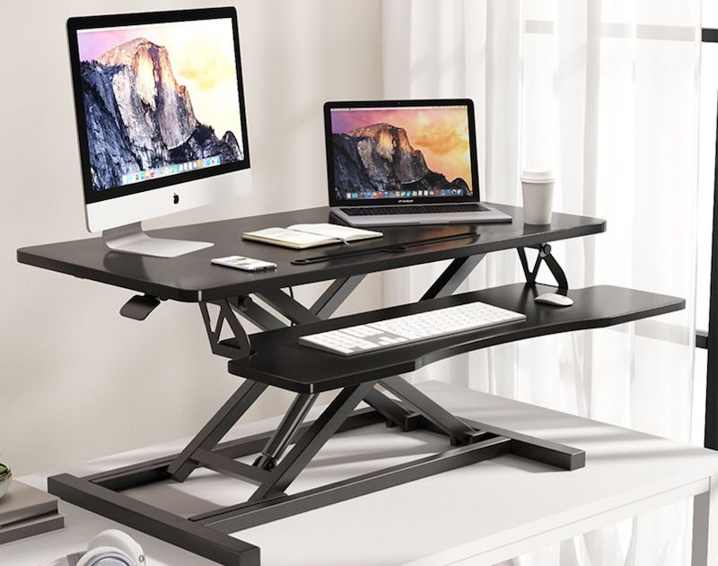
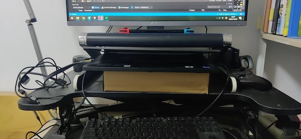

::: {#xp-guide-ergonomics}
:::

::: {.contribution authors="yue-zhou"}

## 缓解腰的问题：升降桌 {#缓解腰的问题升降桌}

在没有读博之前，我就患上了严重的腰肌劳损。这个玩意怎么说呢，说是大病吧，他不是，但无时无刻不在折磨着你。最严重的时候，疼的我晚上都睡不着。去医院看过也开过药，但医生说这个病需要自己保养，无法根治。后来我试着跑了半年步，哎！腰肌劳损神奇的好了，现在一点都不疼了（如遇久坐，仍旧是不行的，会疼）。读博之后也没有心情运动了，于是买了一个升降工作台（推荐人手一个！太好用了！）。可以站着办公，站累了就坐下办公。极大程度上杜绝了久坐对腰椎的伤害。

(资料日期：2022年12月30日)

:::

::: {.contribution authors="jialin-wang"}

## 来自重度腰椎间盘突出、颈椎病患者的深度建议 {#来自重度腰椎间盘突出颈椎病患者的深度建议}

### 升降桌：可极大缓解腰椎问题，但不能完全解决 {#升降桌可极大缓解腰椎问题但不能完全解决}

我十年腰椎间盘突出加五年颈椎病，19年的时候腰就疼到没法坐一整天，就在实验室放了台升降桌，站着用了三年电脑。今年还在卧室里放了同款升降桌。但长期站着和坐着一样对腰不好，最后会变成站着和坐着一样会腰疼。升降桌不是长久之计，站着只是换了角度继续损耗腰椎。

不能完全依赖升降桌：这几年太依赖升降桌，导致现在长时间站着和坐着一样腰疼，去拍核磁医生都问我是不是腰骨折了。如果真的想缓解腰疼，就要避免久坐久站。中学教师容易得腰疼一方面就是因为站着讲课时间长了。

总之升降桌可以用，但不能长期用它代替坐着用电脑。可以交替用，平时再多锻炼就行。

注意事项：升降桌记得没事调一调高度。我放实验室里的升降桌几年没调好像液压杆生锈了，都调不动了，直接变成了一般桌子。

### 外接屏：避免和缓解颈椎病 {#外接屏避免和缓解颈椎病}

颈椎病难受的一点就是，低头时间长就脖子疼，出门在地铁高铁上我都不得不把手机竖起来抬高和眼平行，不然用不了太长时间。

我再贡献一个避免和缓解颈椎病的方法，就是不要长时间用笔记本电脑，长时间低头看屏幕会演变成颈椎病。低头看手机也是。

如果常用笔记本电脑就要在卧室和办公室都放一个台式机屏幕当外接屏。

我颈椎病就是高强度用了一年笔记本电脑得上的，后来只用外接屏就不再继续加重了。

如果经常高强度用笔记本电脑，不用外接屏的话和整天低头用手机一样都是颈椎杀手。我在实验室看见有人长时间用笔记本都会劝他们用外接屏。

笔记本支架也可以，比显示器便宜。但如果视力不好，还是尽量外接屏，因为笔记本屏幕太小了，费眼。我以前也买了很多笔记本支架，现在都用来放显示器了，笔记本刚好能放在下面很方便。

*我自己在卧室里就是升降桌，配笔记本支架。这个组合很适合我这种主要用笔记本的*

### 最好的解决方案：改变生活习惯、加强锻炼 {#最好的解决方案改变生活习惯加强锻炼}

建议有腰椎间盘突出和颈椎病的人还是多锻炼。但不要盲目去健身房锻炼，最好的锻炼方法还是游泳，因为其他锻炼方式大多会需要腰部用力，加重腰疼。

我目前只是偶尔腰疼到不能弯腰。我还认识腰疼到走路一瘸一拐的，他也是慢慢锻炼才逐渐好转。

如果自制力不强，加学校游泳社团也行，起码有人经常一起去锻炼能有动力。

办卡的话，我记得每年九月份独墅湖游泳馆能办半价年卡，但学校社团很便宜，更划算。以前我办游泳卡前每周都跟着学校游泳社团去游一两次，办了年卡后，一年去了不到五次，后来就去得更少了。 如果自制力可以，每天锻炼是最好的方法。 如果坚持不下去，还无法改变生活习惯，就会越来越严重。

最后，如果腰疼比较严重，有空可以去医院骨科看看，做一下核磁，看一下腰椎到底发展到哪个地步，来决定怎么具体该恢复。现在腰疼在年轻人里很普及。

(资料日期：2022年12月30日)

:::
