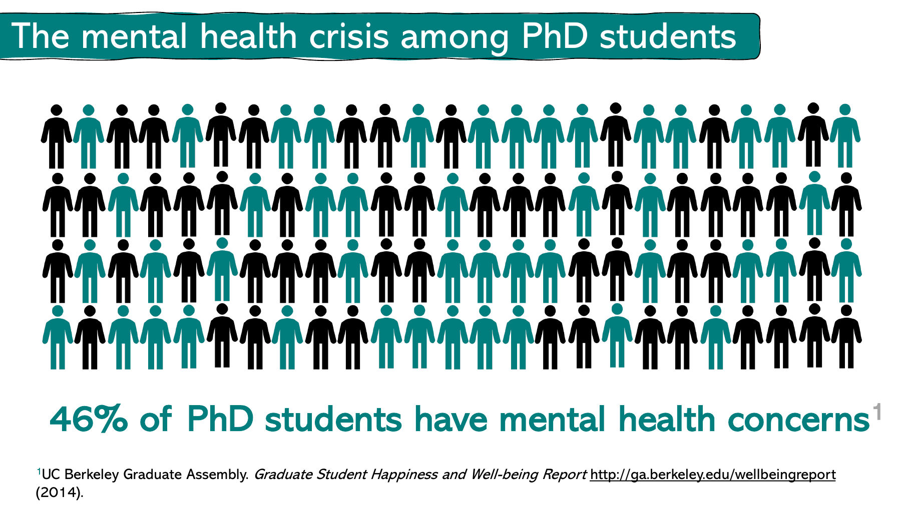
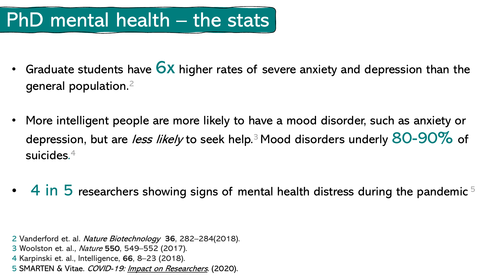
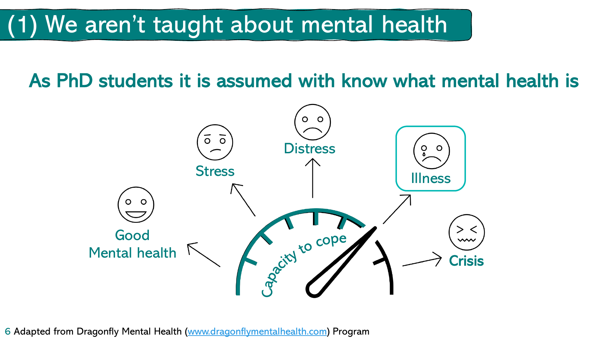

::: {#xp-guide-mental-health}
:::

::: {#sec.mental_health}
:::

::: {.contribution authors="unknown" status="unverified"}

[下载原始 PDF](../../assets/imported/Kai.Wu/mental_1.pdf)

[下载原始 PDF](../../assets/imported/Kai.Wu/mental_2.pdf)

[下载原始 PDF](../../assets/imported/Kai.Wu/mental_3.pdf)

伯克利研究生会2014年发表的[研究生幸福和健康报告\[链接\]](http://ga.berkeley.edu/wellbeingreport)显示，46%的博士生存在心理健康问题。Nature等权威杂志发表的研究认为，

1.  研究生患严重焦虑和抑郁症的比例是普通人的6倍 [\[文献链接\]](https://www.nature.com/articles/nbt.4089)

2.  更聪明的人更有可能患情绪障碍，如焦虑或抑郁，但不太可能寻求帮助 [\[文献链接\]](https://www.nature.com/articles/nj7677-549a)

3.  情绪障碍在自杀中占80-90％ [\[文献链接\]](https://www.sciencedirect.com/science/article/pii/S0160289616303324)

4.  新冠大流行期间，每5位研究者中就有4位表现出收精神健康困扰的迹象 [\[文献链接\]](https://www.tandfonline.com/doi/full/10.1080/21568235.2021.1992293)

*和一个已毕业的同学聊天的记录。抑郁在我们学校博士生的发生率也比想象高得多*

作为高危人群的我们，接受了大量专业知识技能的训练，却几乎从没有人教我们「如何保持精神健康」。如果你现在经常感受到紧张、焦虑、失望，甚至因此有失眠等症状，请立即正视你自己的情况，把你的健康放到第一位，同时feel free to寻求学校心理咨询室的帮助。

同时，事前预防永远比事后治疗有效。希望读到这里的同学，不管你现在是否感觉良好，都点击下面的链接，读一读Zoe Ayres在利物浦的演讲（就是上面几张PPT的出处）和她的《*Managing Your Mental Health During Your PhD - A Survival Guide*》一书，健康度过研究生生涯。  [\[GitHub链接\]](https://github.com/kaiwu-astro/xp_pgrs_unofficial_guide/tree/main/fileshare)     [\[不能上GitHub的用这个链接\]](https://gitee.com/kaiwu-astro/xp_pgrs_unofficial_guide/tree/main/fileshare)

:::
