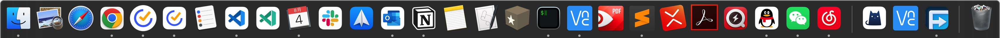
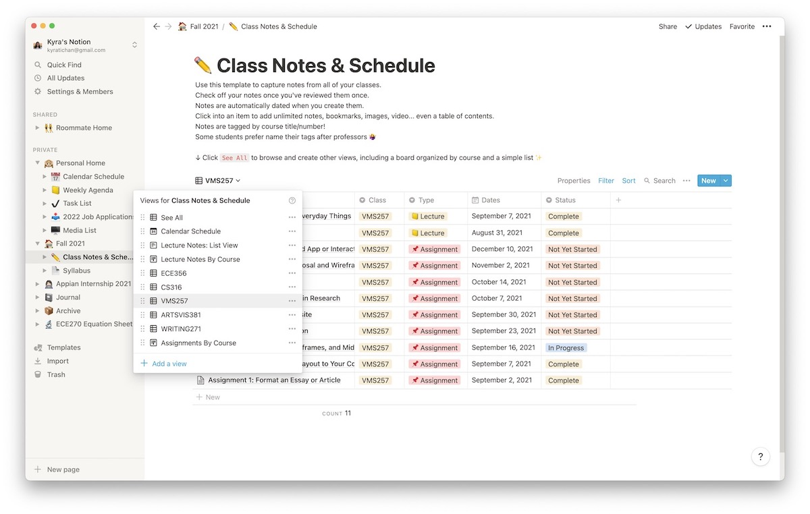
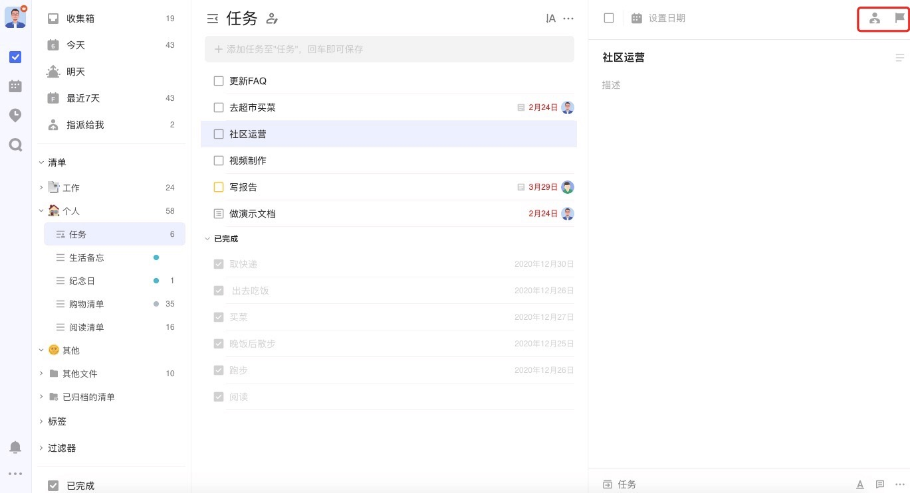
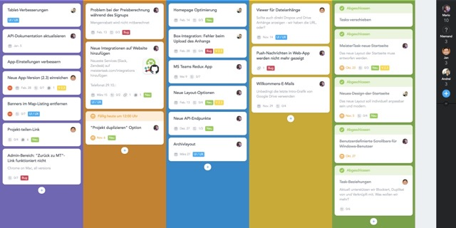
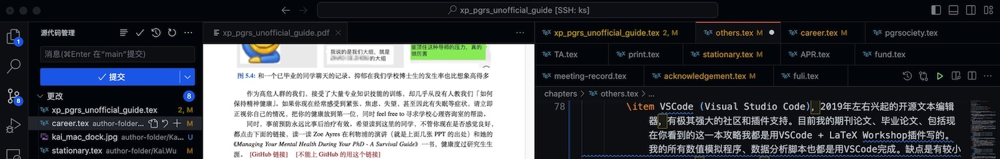
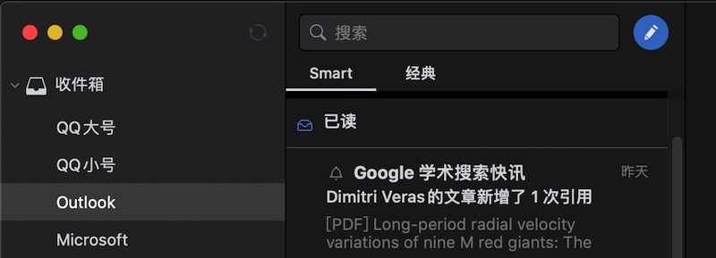
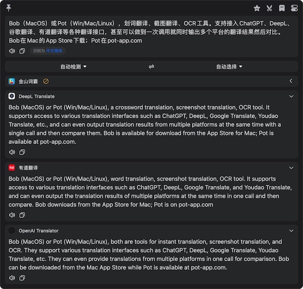

::: {#xp-guide-recommended-software}
:::

::: {.contribution authors="kai-wu"}

[吴开](mailto:kaiwu.astro@gmail.com)：我来抛砖引玉说一些我一定会推荐同门师弟尝试的软件：

- 科研和生产力工具

  1.  Notion （全平台）。无比强大的新一代笔记软件。我本来是Onenote重度用户，用Onenote记了7年笔记过后偶然被介绍了Notion，在尝试了很短时间过后就决定放弃用顺手的Onenote，完全转投Notion。推荐理由：Win/Mac/Linux/网页/iOS/Android全平台支持；强大的数据库功能，可完美构建自己的GTD系统，大幅提高效率；快速的全局搜索；现代化的协作功能，甚至可以用来做团队管理和Project management；强大的分享功能，可以轻易把笔记分享成公网网页；b站有大量教程。

      

  2.  滴答清单 （全平台）。我用过很长时间的Wunderlist（后被微软收购变成Microsoft to-do）、iOS自带的提醒事项和其他好几种清单软件，只有滴答清单用起来最顺手、最符合直觉。搭配Notion使用，可以方便的管理好学习、生活的所有大小事。支持全平台。

      

  3.  Trello (全平台）。卡片式管理你的待办事项和任务。我导师一直严重依赖Trello来把他的暴多事情管理得井井有条。虽然我认为Notion是Trello的子集，但如果你因为某些原因不喜欢Notion，至少可以尝试下Trello。全平台即可下载。

      

  4.  VSCode (Visual Studio Code) （PC全平台），2019年左右兴起的开源文本编辑器，有极其强大的社区和插件支持。目前我的期刊论文、毕业论文、包括现在你看到的这一本攻略我都是用VSCode + LaTeX Workshop插件写的。我的所有数值模拟程序、数据分析脚本也都是用VSCode完成。缺点是有较小的上手难度，需要折腾配置；以及和Chrome一样占内存。

      

  5.  Spark。苹果多年的最佳App开发者Readdle做的邮件app，一站式管理所有邮箱，能把邮箱配置同步到云端，解决了每买一个新设备就要重新添加一大堆邮箱的问题。似乎是Mac和iOS独占，不确定其他平台有没有。

      

  6.  文献管理软件就不推荐了，萝卜青菜各有所爱，没有的赶紧去问师兄师姐或者上b站看推荐。

- 效率工具

  1.  Bob（MacOS）或Pot（Win/Mac/Linux），划词翻译、截图翻译、OCR工具。支持接入ChatGPT、DeepL、谷歌翻译、有道翻译等各种翻译接口，甚至可以做到一次调用就同时输出多个平台的翻译结果然后对比。Bob在Mac的App Store下载；Pot在pot-app.com

      

你有发现什么很好用的软件吗，希望不吝赐教分享给学弟学妹

你的推荐：

:::
