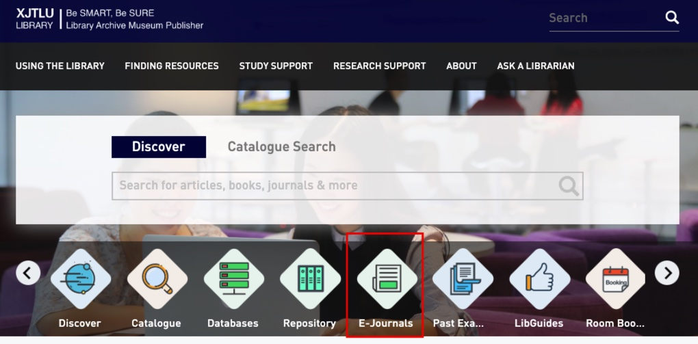

::: {#xp-guide-library-databases}
:::

::: {.contribution authors="editorial"}

资源来源：西浦图书馆的文献数据库与访问入口。

:::

::: {.contribution authors="unknown" status="unverified"}

连接校园网后，绝大部分学校订阅了的期刊论文都可以直接在论文页面下载，但(1)有的期刊官网不能识别你的IP，甚至例如著名的Annual Review系列 (2)如果你在校外也想下论文，这时就可以用到图书馆的论文数据库

我用得最多的是在首页 <https://lib.xjtlu.edu.cn> 点击e-journal，按期刊名称搜索期刊，然后就可以跳转专有链接访问。同时，图书馆还提供了很多全文数据库，甚至还有知网等中文期刊数据库。详细的使用姿势，见图书馆往期培训 <https://core.xjtlu.edu.cn/course/view.php?id=905> ，或者直接本项目的GitHub里（[链接](https://github.com/kaiwu-astro/xp_pgrs_unofficial_guide/tree/main/fileshare)）找到PPT。

:::
