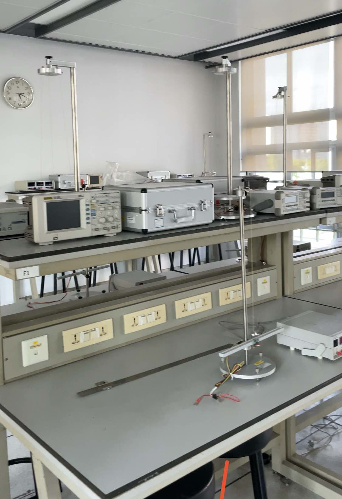

::: {#xp-guide-teaching-assistant}
:::

## 我是否需要做TA？ {#我是否需要做ta}

::: {.contribution authors="editorial"}

奖学金条件及 TA/RA 工作义务已单列为[奖学金与 TA/RA 义务](../academic/ta-obligations.qmd#ta-obligations-requirements)。

:::

## 如何成为一名TA {#如何成为一名ta}

::: {.contribution authors="yue-zhou"}

每学期的第一周前后，学院会招募TA，一般由学院的秘书（School Academic Administrator）联系大家。

- 半奖及自费博士比较自由，可自行与任课老师联系

- 全奖博士分两种情况：a.自行与任课教师联系 b.学院直接发邮件分配

如果你很想参加，或者想早点占某个科目、某为老师的坑，可以尽早联系秘书以及对应的科任老师。

(资料日期：2022年12月30日)

:::

## TA的工作种类，以及分别怎么做 {#ta的工作种类以及分别怎么做}

::: {.contribution authors="unknown" status="unverified"}

助教的工作包括不局限于

1.  批改作业及试卷

2.  给本硕学生上tutorial（商科居多）、上lab

3.  核算登记课程分数

4.  做一些辅助性的工作（如设置Learning Mall等）

5.  期中、期末监考

研究生院会组织TA培训，以*Teaching Assistant (TA) Training Programme*为题的邮件通知，也可以直接在你的Learning Mall上找到。每学期都有。如果一次都没去过，最好至少去听一次。下面是比较核心的、学校培训讲不太明白的内容：

:::

### 批作业 {#批作业}

::: {.contribution authors="editorial"}

阅读独立的[作业批改教程](marking.qmd#marking-assignments)。

:::

### 批改试卷 {#批改试卷}

::: {.contribution authors="editorial"}

阅读[试卷批改说明](marking.qmd#marking-exams)。

:::

### 带Lab（实验课） {#带lab实验课}

::: {.contribution authors="kai-wu"}

像大学物理实验这种课，会让TA带实验课。物理实验的讲课流程一般是：先在实验室的白板给学生讲一下实验原理、数据如何记录和处理、注意事项，然后要亲手演示如何做实验。课后，要批改实验报告。

我感觉，实验课非常有挑战性，因为确实就是实实在在的在大学里讲课。你需要自己花时间备课、准备讲稿、理清思路、准备学生可能问的各种问题；讲课前科任老师会对TA在实验室培训，你自己得先吃透如何做实验。还有突发事件如何处理，比如学生弄坏器材（及时问老师）。因为实验课就那么几节，总的工作时长加上批实验报告也比大部分其他课的批作业时长要少，但是非常锻炼人。可以挑战自己，如果不想干也一定要尽早跟老师、学院秘书提出换到其他课程。

(资料日期：2022年10月22日)

:::

### 如何做好讲Tutorial（习题课） {#如何做好讲tutorial习题课}

::: {.contribution authors="yue-zhou"}

1.  课前做好充分准备工作，当你站上讲台那一刻，你就是一名教师了，要为自己说的所有的话负责，也要对学生负责。课前将课程所需要的材料拷到U盘中，进入教室后打开电脑登录自己的账号即可使用电脑。同时你也需要使用账号登录LM, AMS等乱起八糟的系统。由于学校电脑较卡顿，建议大家提前十分钟到达教室。此外，也需要提前十分钟下课，否则会被后面上课的老师和学生投诉你拖堂。

2.  课后耐心回复学生的邮件与提问。此处给大家一个忠告，不要加轻易加学生微信，让他们有事有问题跟你邮件联系。否则你会变成一个7\*24客服。邮件作为学校官方交流方式，很好的保护了教师和助教的私人空间和权益。曾经有学生投诉，就因为助教没有回复学生的微信。

3.  有问题及时跟module leader沟通，遇到棘手的问题，不要自作主张，需要与module leader商量。学生给的反馈，也可以与co-teacher沟通，以提升学生的学习体验。学生体验感好了Module Questionnaire（MQ）分数自然就上去了。MQ的分数即学生评教分数，如果分数好看，求职的时候，是可以放到简历里的。

(资料日期：2022年12月30日)

:::

## TA工资是多少，怎么结 {#ta工资是多少怎么结}

::: {.contribution authors="unknown" status="unverified"}

2022年TA工资是60元/小时，每月一结，次月月底发钱。例如，2月底发1月工作的工资。

另外，期中、期末考试的监考也是TA的一种，会计入奖学金学生的TA工时，对自费同学，监考的工资单价一般也高得多。监考见[监考怎么做](invigilation.qmd#xp-guide-invigilation)。

:::
