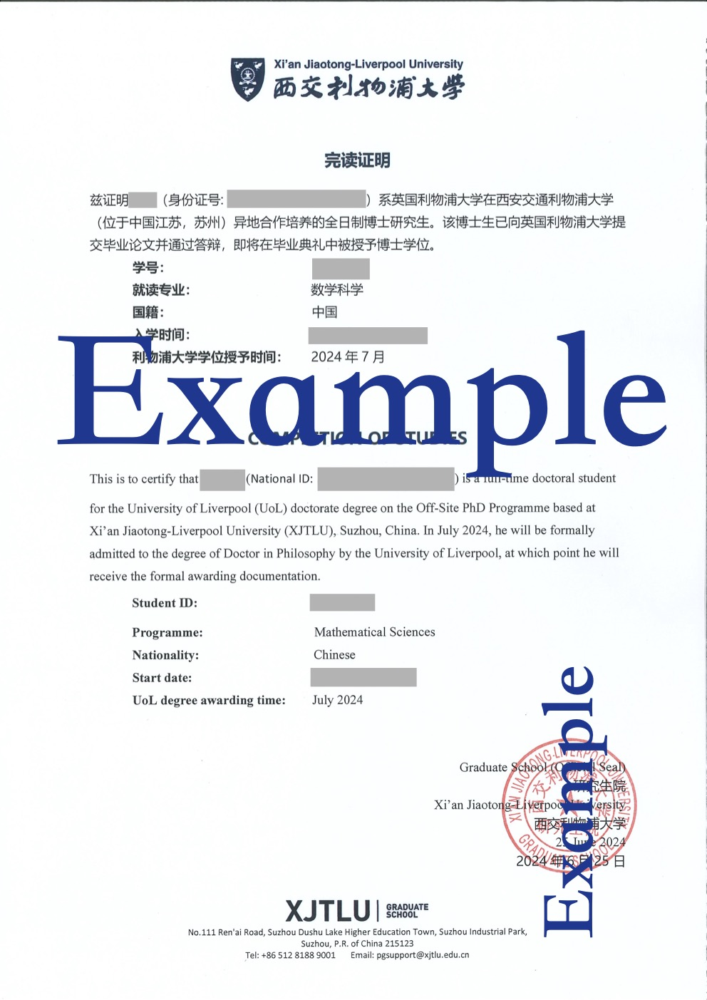

::: {#xp-guide-degree-documents}
:::

## I want my degree certificate as soon as possible! Getting through graduation quickly {#degree-documents-overview}

::: {.contribution authors="kai-wu"}

In a hurry, in a hurry, always in a hurry: you are the king of impatience. Here is what every properly impatient person needs to know.

:::

### Documents proving completion and graduation {#degree-documents-evidence}

::: {.contribution authors="kai-wu"}

1. The Completion of Studies Certificate is issued by the XJTLU Graduate School. It states that you have submitted the thesis, passed the viva, and will be awarded the PhD at the graduation ceremony in month X of year XXXX. My example:

   

   *For reference only, with a large EXAMPLE watermark to prevent unlawful misuse.*

2. The degree certificate, also called the PhD degree or degree certificate. Note: Liverpool awards degrees only at a **Liverpool** graduation ceremony, and Liverpool holds ceremonies only twice a year, usually on a day in July and a day in December. If you do not attend, you first receive an electronic certificate around the ceremony date. It has legal effect and can be used for credential recognition for Chinese-foreign cooperation programmes. The original then makes its leisurely way by post to XJTLU.

3. Credential recognition for a Chinese-foreign cooperation degree. You can apply once you receive the electronic certificate: <https://zwfw.cscse.edu.cn/>. With this recognition, the Ministry of Education recognizes your Liverpool degree in China.

First establish which documents your future company or employer accepts. The most flexible may accept Liverpool's confirmation email saying "Pass", with minor or major modifications, after the viva. Some accept the Completion of Studies Certificate. If they insist on the degree certificate, or even on the Chinese-foreign cooperation credential recognition, plan your graduation schedule especially carefully: certificates are issued only twice a year!

:::

### Degree certificate: the critical deadline {#degree-documents-deadline}

::: {.contribution authors="kai-wu"}

If you are sure there is no rush to obtain the degree certificate, you can ignore the rest of this section, because the Completion of Studies Certificate can be issued at any time.

Q: Can I graduate in July or December? What is the hard requirement?

A: The best approach is to check Liverpool's website directly or Google "liverpool phd graduation". In recent years, the requirement has been that Liverpool Library confirm receipt of your ~~ultimate absolutely-no-more-changes~~ final thesis before a specified date. For example, to join the Liverpool graduation ceremony on 15 July 2024, when the degree certificate would be awarded or mailed, Liverpool Library needed to confirm receipt by 25 June 2024. This is the final version approved by both your internal and external examiners. How do you get there?

:::

::: {.contribution authors="editorial"}

For the steps leading to final submission, see [the graduation timeline](graduation.qmd#sec.graduation.time).

:::
