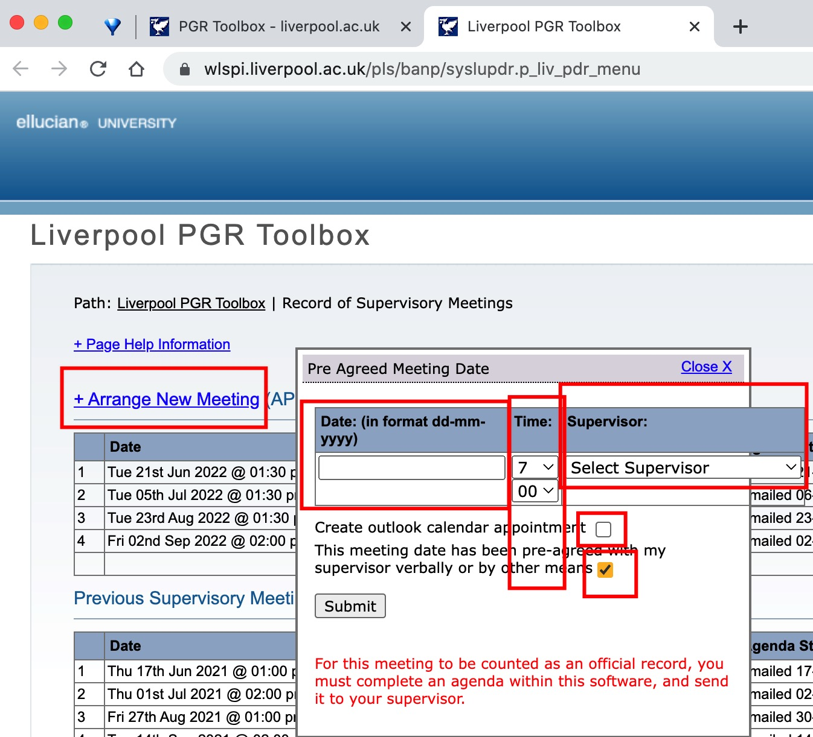
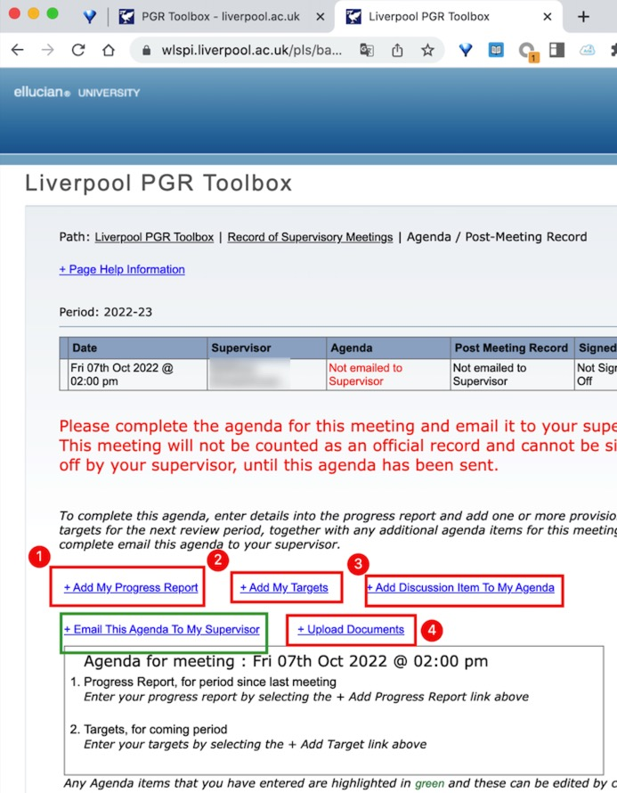
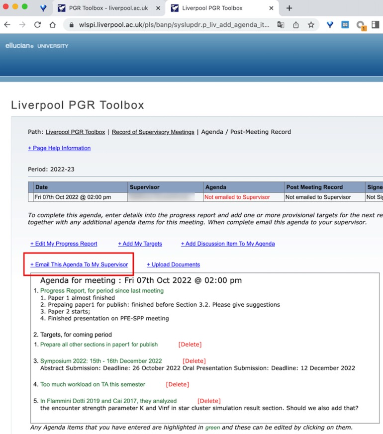
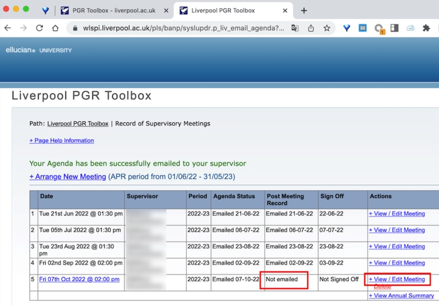
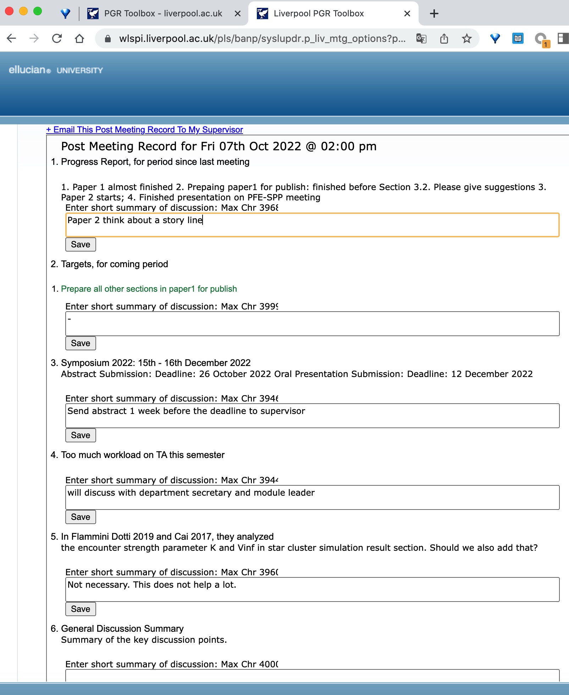

::: {#xp-guide-meeting-records}
:::

::: {#sec.meeting_record}
:::

::: {.contribution authors="kai-wu"}

As part of the APR requirements, every student registered as a Liverpool PhD student must record the dates and content of supervisory meetings in a system called Liverpool Life. Here is how to do it.

1.  Visit Liverpool Life at <https://liverpool-life.liverpool.ac.uk/> and log in using your Liverpool student number and password. Use your student number, not your email address, and certainly not your XJTLU student number.

2.  Find "PGR Record of Supervisory Meetings" and click "View all meetings".

3.  Click "Arange new meeting". In the pop-up, enter the date and time and select your supervisor. Once you have completed all the following steps, the selected supervisor will receive an email at their Liverpool address. Untick the first option, "create calendar appointment"; otherwise it creates an appointment you probably will not use in your Liverpool email calendar. XJTLU students generally use the calendar associated with their XJTLU email and may never use Liverpool's. Then tick "has been pre-agreed" below.

    

4.  Recall what you discussed at your most recent meeting. Fill in the progress report (what you have done), targets (what you plan to do before the next meeting), and discussion items.

    

5.  You do not need to write a great deal, but do not make it perfunctory: Liverpool does check these records. When finished, click "email this agenda". You and your supervisor will both receive an automatically generated email at your Liverpool addresses.

    

6.  Do not close the page yet. You still need to enter the comments from your meeting. Click "view edit meeting" on the right.

    

7.  Enter the meeting comments. Finally, click "email" at the top left. You and your supervisor will receive another email at your Liverpool addresses.

    

8.  You have now finished your part. Your supervisor must click "sign off" in the email sent to their Liverpool address. You will then receive an email with a subject such as *PGR Supervisor Meeting 5 (Fri 07th Oct 2022 @ 02:00 pm): sign off comments*. Only then is that meeting record complete. Before each annual APR, at least one meeting per month must have been signed off. Remind your supervisor if they have not signed off.

**A few points to bear in mind**

- It is best to enter a record every month. Backfilling several months, or even half a year's records in one go, is allowed, but it is not good practice. In my experience, waiting until just before the APR means you may forget what you actually did during the year, and that is a busy time anyway. Try to follow the monthly schedule.

- Liverpool Life and the record-entry system are **frequently inaccessible** because of network and system problems. Even on XJTLU Wi-Fi or wired connections, access can be hit or miss. Students who have tested it report much better connectivity with an internet-circumvention tool in global-proxy mode. However, I cannot teach these potentially unlawful methods here, and they must not be discussed on WeChat or QQ, where accounts or groups could be suspended. If you do not know how to use such tools, fill in your records particularly early: being unable to log in at the deadline is even more stressful.

(Information dated: 10 October 2022)

:::
