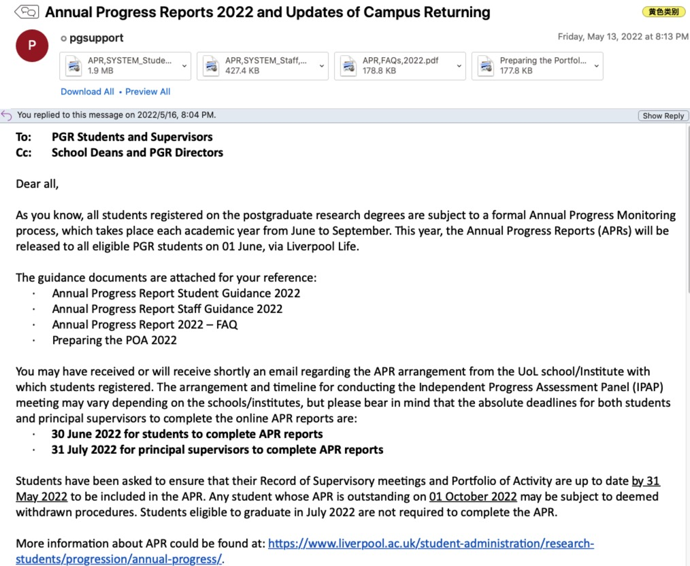
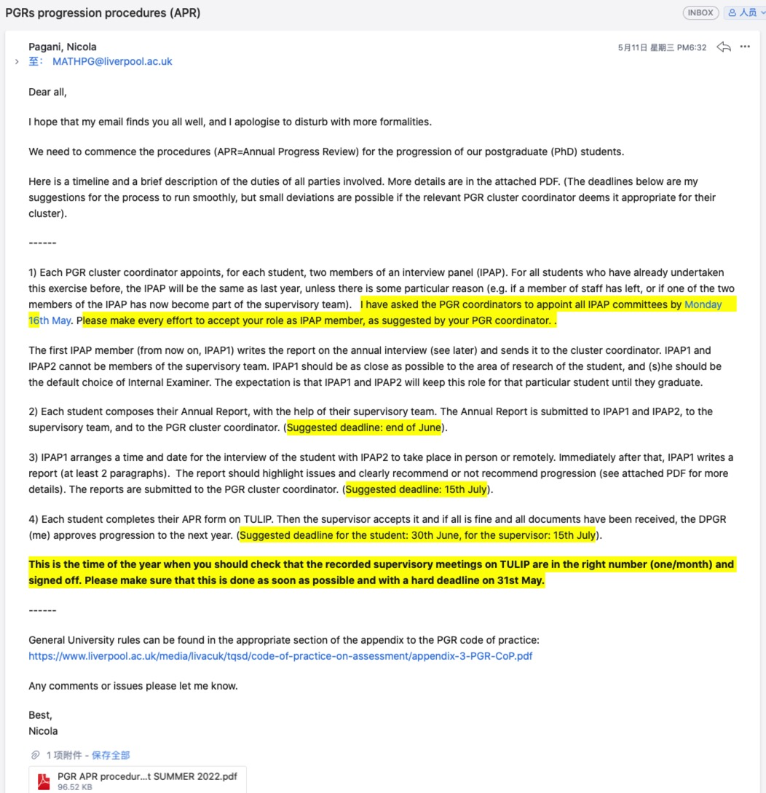
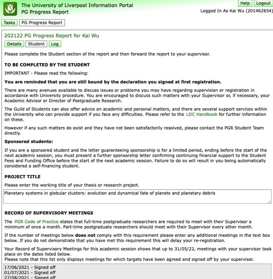

::: {#xp-guide-apr}
:::

::: {.contribution authors="kai-wu"}

## What is the APR? {#apr-是什么}

First, read the official guidance. If you have not read it, please read every word: the APR is as important as a small viva. Failing it can lead to your withdrawal from the programme.

<https://www.liverpool.ac.uk/student-administration/research-students/progression/annual-progress/>

As I understand it, the APR serves these purposes:

- Interview: doing a PhD is difficult, so the University and your school need to understand the problems students face and help resolve them.

- Seminar: practise presenting and get to know other PhD students.

- Progress report: check students' progress, identify problems, and help address them. It also identifies students who are making no serious effort to study.

Some students are very nervous about their first APR. In practice, for the progress-report component, reviewers will not go out of their way to fail you unless you have spent the entire year doing nothing: no books, papers, writing, surveys, experiments, coding, or any other work. I heard that a student in one school failed the 2022 APR. A reliable source said the student had virtually disappeared, never replied to their supervisor, and did no work; that was why they failed.

Remember that another major function of the APR is to help you solve problems. You should therefore feel able to raise difficulties openly and ask for help (see [IPAP interview](apr.qmd#sec.IPAP)).

## The APR process {#apr-流程}

### Preparation {#准备工作}

There is only one prerequisite for the APR: complete your meeting records for **at least one meeting every month**. See [Liverpool Life meeting records](meeting-records.qmd#sec.meeting_record) for instructions.

Each year there are then two important APR emails:

1.  The first comes from XJTLU in May, is sent to your XJTLU email, and looks roughly like this.

    

2.  The second comes from your Liverpool school in April or May and is sent to your Liverpool email. The Mathematics version looks roughly like this; other schools may differ. Notification dates vary considerably: some send theirs in April, while others wait until late May.

    

APR requirements differ slightly between schools, so make sure you check your Liverpool email around May. Read both messages carefully. **For your first APR, I suggest reading every word of both emails and their attachments.**

The APR consists of the following four components.

### TULIP online form {#tulip-网页表格}

When the Liverpool or XJTLU email says "Your annual progress report has been released", it means you can fill in this very green form. Its main sections are:

1.  SUMMARY OF PROGRESS: a progress report of more than 300 words and fewer than 4,000 characters (approximately 600 words).

2.  Seminars and Conference attendance, Library and IT training and all subject specific training including research methods and experimental techniques. Think back over the conferences, seminars, and specialist training you attended. More is better, but it is fine if you have none.

3.  Attendance at careers events and workshops covering Employability and Entrepreneurship and including attendance at any other Professional development workshops. List career-related activities. More is better.

4.  Training and completion of activities relating to Health and Safety, ethics, grant writing and similar activities, including Project Management. List activities outside your immediate academic work that are nevertheless relevant. More is better.

5.  Details of your Presentations, written publications, teaching and public engagement/Impact activities and related training in for these activities. Include presentations, published papers, and teaching assistant work. More is better.

6.  PERSONAL OR ACADEMIC PROBLEMS: Have there been any problems in the last year which you feel have affected your progress? Answer according to your circumstances. Describe obstacles to your studies honestly; you can also explain mitigating circumstances: "My progress was limited because of..." illness, getting married, the University network, reading English too slowly, or gaps in particular skills, for example.

Everyone must complete TULIP, regardless of school. For the following three components, **requirements may vary greatly between schools and also depend partly on which Liverpool school you belong to**. Double-check with senior students if needed.

### Annual Report (AR) {#annual-report-ar-年度报告}

Simply put, **write a document describing what you have done**. There is usually a word or page limit. If you really do not know what to write, I suggest recording the details chronologically, ~~like a running diary~~: what you read and learned, what code you wrote, or what experiments you conducted. Academic activities are also important: conferences, meetings, and University TA work can all go in. In other words, explain the TULIP information again in a document. It is largely a matter of copying it across and expanding it if you need more words.

Follow any specific requirements instead. For example, if Mathematics only asks Year 3 students for a Thesis Outline, you do not need to write that running diary.

Note that this description of the AR is based on my experience in Mathematical Sciences. Students elsewhere have told me their requirements are similar, but some schools ask for much more. According to one Chemistry student, their first year required a 30-50-page literature review. That needs one or two months of advance preparation. **New students should ask senior students or their supervisor.**

### Annual Seminar {#annual-seminar-年度研讨会}

A school or department generally gathers its PhD students to present their work, exchange feedback, and get to know one another. As far as I know, some small departments skip this component or combine it with the interview below, asking you to present to two academics. Whatever the format, **prepare a slide presentation** that explains your research. A useful starting point is 20 minutes of presentation plus 5 minutes of questions, but requirements may differ; ask senior students. If you have many results, select the important ones. Otherwise, a chronological account of what you have done can fill the time and show the academics that you have worked hard.

### IPAP interview {#sec.IPAP}

Your school will arrange an interview with two academics who are not your supervisors and have no conflict of interest with you. You may need to **prepare slides** in which you can openly describe difficulties. You can discuss all the issues below with the IPAP academics; their role is to do their utmost to help you resolve them.

- Equipment: University computer faults, such as awkward operation, freezes, or crashes; office conditions, such as air conditioning blowing directly at you.

- Research itself: not reading enough papers without knowing how to read more efficiently, not knowing experimental methods, struggling to write, or being unable to attend many conferences for reasons beyond your control. During the pandemic, for example, we raised its effects at every APR.

- Supervision: a supervisor who exploits you, demands a 996 schedule, or leaves you exhausted; asks for unrelated work such as moving house, collecting food deliveries, or processing their reimbursements; is harsh or excessively pushy and keeps you constantly tense; frequently calls or messages outside working hours so that you cannot rest; takes first authorship of your papers; or repeatedly disappears and leaves your messages unanswered for days. These are serious failures of supervision. Any of them can create substantial psychological strain and harm your work. This is exactly what IPAP is for: discuss it clearly with your interviewers.

- Emotional or mental health difficulties: anxiety, tension, insomnia, or depression. If you are struggling, contact the University's counselling service promptly at <counsellingservice@xjtlu.edu.cn>; it is free.

- Family pressure: for example, your family expects you to graduate in three years and you find the pressure overwhelming.

- Financial pressure, physical illness that may require an interruption to recover, or any other issue affecting your PhD work.

The main purpose of the APR is to identify and address problems so that you can begin the next academic year. For anything the APR cannot conveniently address or resolve, speak promptly to your supervisor, head of department, dean, DA, or the University counselling service. Also see [Taking emotional difficulties and depression seriously](../life-tools/mental-health.qmd#sec.mental_health).

(Information dated: 12 October 2022)

:::
