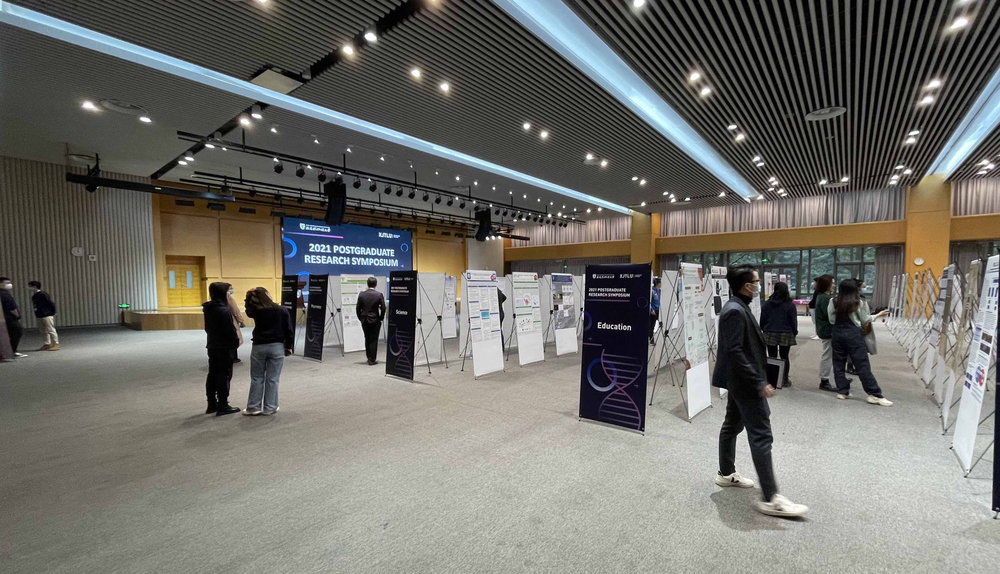
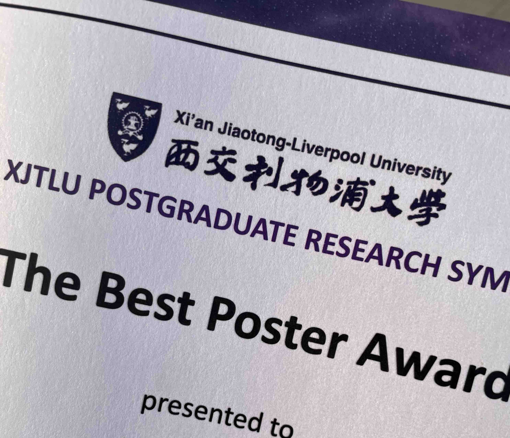
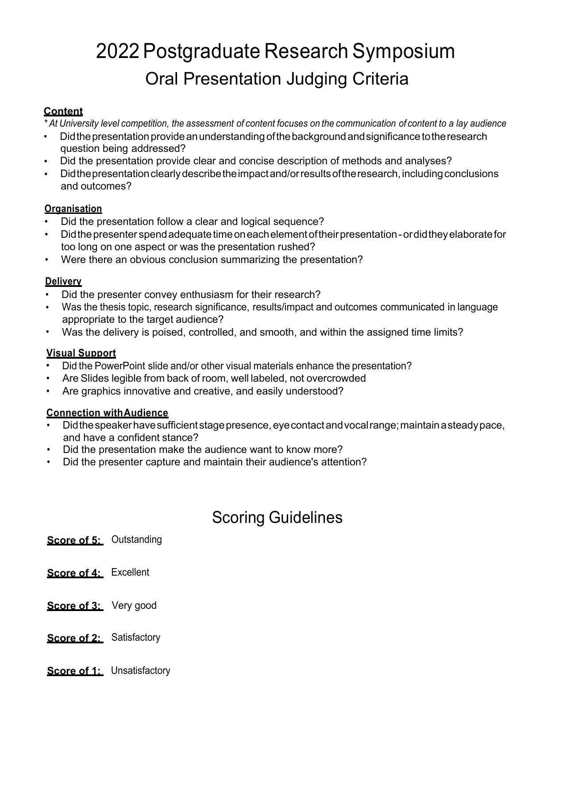
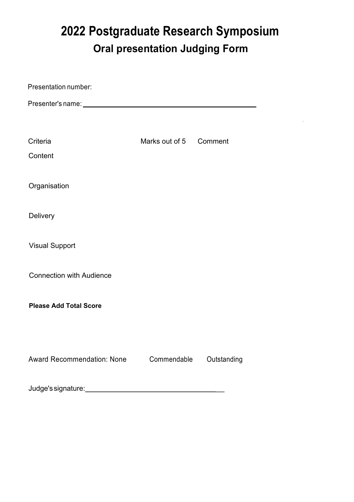

::: {#xp-guide-research-symposium}
:::

::: {.contribution authors="kai-wu"}

## What is XPGRS? {#xpgrs是什么}

The XJTLU Postgraduate Research Symposium, abbreviated to XPGRS or simply Symposium, is organised by the Graduate School. Its official Chinese name is "博士生论坛". Each December, PhD students from across the University present their research results or progress through posters or oral presentations. The year's XPGRS is announced by email around the National Day holiday.

## Which activity do I need to take part in? {#我需要参加哪一项}

The official requirements are:

- Second-year PhD students give a poster presentation.

- Third-year PhD students give an oral presentation.

- Students in their fourth year or above are invited to chair sessions.

- Master's students at the dissertation stage are also welcome.

Based on what has happened in previous years, this translates into:

- First-years do not have a required activity, but can consider volunteering when the recruitment email arrives, or simply visit to learn about senior students' work.

- Second-years must present a poster.

- Third-years must give an oral presentation and can consider chairing.

- Fourth-years and above have more freedom to choose.

Your year is determined as of 1 December. This is straightforward for students who enrolled between March and September, but many enrolled on 1 December itself. According to information from 2022, those students were required to take part: someone enrolled in December 2021, for example, needed to present a poster in 2022.

December entrants are a special case and policy may change, so it is best to email or phone the Graduate School each year to ask.

In theory, you can take part in both posters and oral presentations every year if you wish! You can even never attend, provided your supervisor agrees. Most supervisors want you to gain the practice unless there is a particular reason. If you genuinely have a reason not to attend, your supervisor needs to contact the Graduate School; you can opt out with approval. I have heard of supervisors who consider the Symposium useless and never ask their students to attend, and others who require both a poster and an oral presentation at the first opportunity.

*The 2021 Symposium poster venue, CB G13W, just before the event began.*

## What is it useful for? {#有什么用}

1.  Practise presenting and spoken English, and get advice from academics elsewhere in the University.

2.  Win awards. The University invites academics to listen to your poster or slide presentation and score it. There are Best Poster (10%), Best Oral Presentation (10%), Outstanding Poster (20%), and Outstanding Oral Presentation (20%) awards. You receive a certificate and RMB 1,000 or 500 in... conference funding. See [Conference funding](../resources/conference-funding.qmd#sec.fund) for how it can be used. It is not a cash prize, but it is still useful ~~even if the University is being stingy~~.

## "I don't want to go" - please reconsider! {#我不想去尽量不要}

I often hear students say that the prizes are small, the awards carry little weight, even a Best award is of no real use, and nothing happens if they do not attend. Frankly, that is true: with your supervisor's approval you can legitimately opt out, and even if you simply disappear, little is likely to happen. It is unrelated to graduation.

But as someone who has presented both a poster and a talk, chaired three oral sessions, and listened to many presentations, I strongly encourage you to participate unless presenting is already second nature to you. I have seen students read a script with their heads down throughout, put their whole script on the slides and read it, shake with nerves, make slides with no clear priorities or focus, or become completely lost when academics ask questions. Any one of these can be disastrous in your viva! Our viva is not a formality of the kind you might associate with some domestic universities: you genuinely must present well and answer every pointed question. **Would you rather reveal these problems for the first time at your viva, or discover them early, practise, and address them?**

At the Symposium, you cannot fail: it only awards prizes. The judges are also friendly and will help you find important problems. It is therefore [**an excellent and very safe opportunity to practise**]{.underline}. Do not wait until your viva or a leading conference to get that practice!

## What to watch for and how to do well {#注意事项如何表现出色}

Below are the oral presentation scoring sheets I saw at the 2022 Symposium; enlarge them to read them. Much the same advice applies to posters. Poster presenters should also prepare a talk of about three minutes for visiting judges. Frankly, these criteria matter in any presentation and are useful for reviewing your poster carefully.

*The 2022 scoring sheets.*

[Download the original PDF](../../../assets/imported/Kai.Wu/2022_XPGRS_oral_judging_criteria.pdf)

[Download the original PDF](../../../assets/imported/Kai.Wu/2022_XPGRS_oral_judging_form.pdf)

If you want to do well or win an award, read on.

There are plenty of online tutorials about presentations and posters. The biggest difference between XPGRS and other academic presentations, however, is that most students and even University judges may know absolutely nothing about your field. Different fields can be worlds apart. If you speak as you would to your supervisor, or reuse a poster or slide deck made for a specialist conference without changing it, you may not win: the judges and other students may genuinely not understand you.

My supervisor told me that XPGRS is closer to science communication than a specialist academic talk because you are speaking to non-specialists. Part of its purpose is to interest an outsider in your research in a short time and help them understand perhaps 70% of it. If you are unsure how, imagine meeting Youmin Xi in a lift: how would you quickly explain what you do, why it matters, and ideally make him interested? Or imagine explaining your work to a relative or old school friend when you go home for the New Year. Research is not something to keep behind closed doors. Communicating it and making its results useful to others is also an important skill.

(Information dated: 19 October 2022)

(Major update: 16 December 2022)

:::
