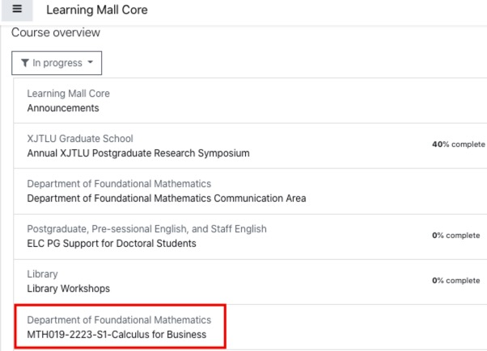
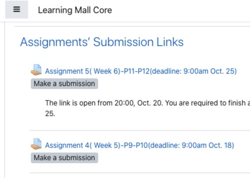
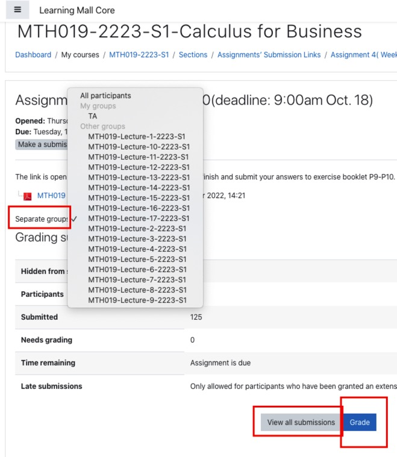
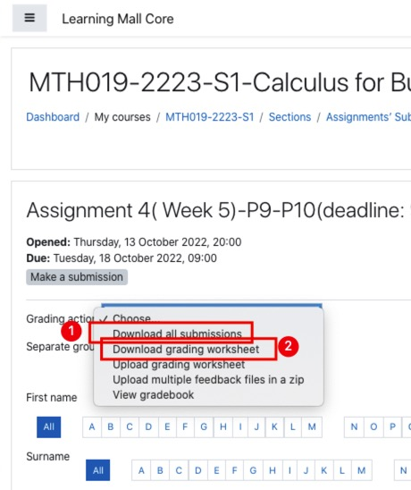
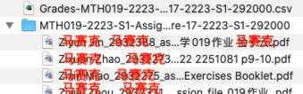
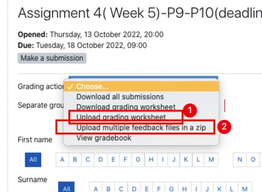
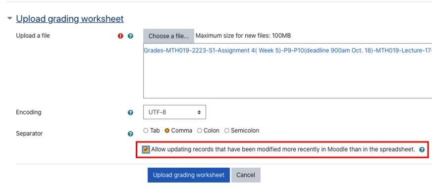
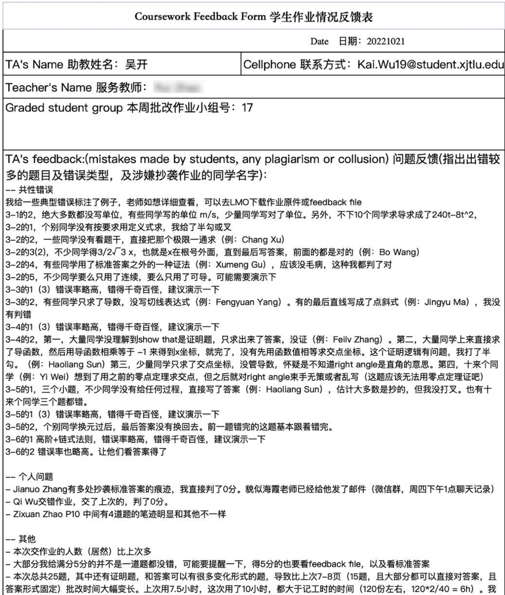
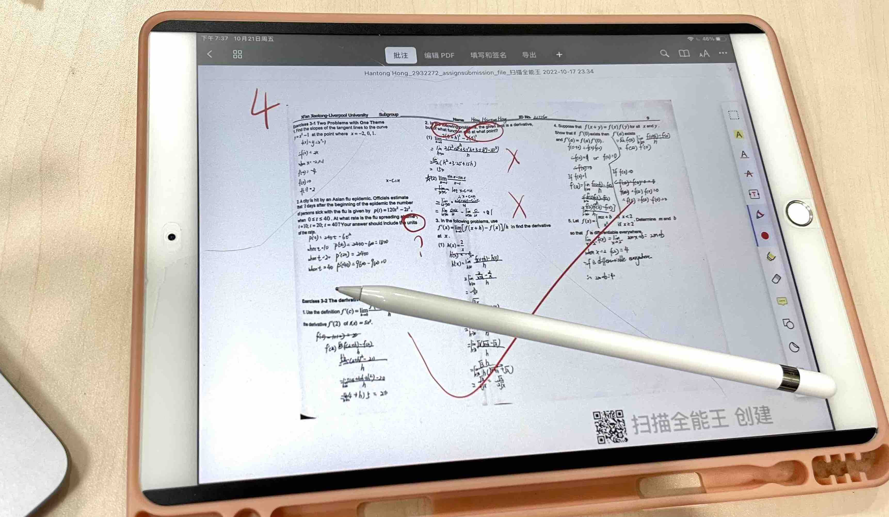
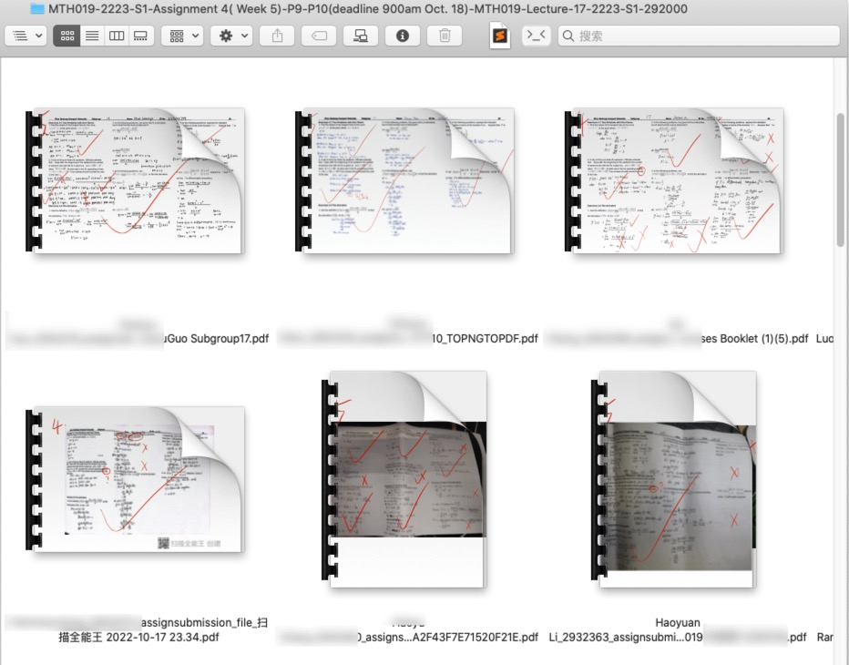

::: {#xp-guide-teaching-assistant}
:::

::: {.contribution authors="kai-wu,yue-zhou" status="unverified"}

## Do I need to work as a TA? {#我是否需要做ta}

- If you are a fully funded PhD student, with both a tuition waiver and a stipend, your Financial Offer from the university obliges you to undertake TA duties every semester. In other words, the scholarship comes in exchange for TA work: if you receive the money, you must do the work. You do not receive additional pay for it. Fully funded PhD students who enrolled in 2020 or later must complete 900 TA hours over three years to graduate. Those who enrolled in 2023 or later must complete 300-500 hours of TA or RA work each academic year to graduate.

- If you enrolled in 2020 or later with a partial scholarship, meaning a tuition waiver only, or are self-funded, you have no obligation to work as a TA. If you do, the university pays you by the hour. Depending on your career plans, TA experience on your CV may also be useful.

For fully funded students, 300 compulsory TA hours per academic year, divided across 40 teaching weeks, means 7.5 hours of duties every week: effectively one day a week gone. You may well ask whether this is really enforced so strictly. In practice, schools vary greatly. Some have even built a digital system specifically to track your hours and require you to complete them all; others are more relaxed. Ask senior students in your own programme how it is implemented.

(Information dated: 21 October 2022)

(Major update: 30 December 2022: TA hours corrected according to the latest official handbook.)

(Update: 15 January 2024: TA hours corrected according to the latest official handbook.)

:::

::: {.contribution authors="yue-zhou"}

## How to become a TA {#如何成为一名ta}

Schools recruit TAs around the first week of each semester. Usually the School Academic Administrator contacts everyone.

- Partially funded and self-funded PhD students have more freedom and can contact module teachers directly.

- Fully funded students have two possible arrangements: (a) contact module teachers themselves; or (b) receive a direct assignment from the school by email.

If you are keen to take part, or want to secure a place on a particular module or with a particular teacher, contact the administrator and the relevant teacher early.

(Information dated: 30 December 2022)

:::

::: {.contribution authors="unknown" status="unverified"}

## Types of TA work and how to do them {#ta的工作种类以及分别怎么做}

TA duties include, but are not limited to:

1. Marking coursework and exam papers.

2. Teaching tutorials, especially in business subjects, or labs for undergraduate and master's students.

3. Calculating and entering module marks.

4. Supporting tasks, such as setting up Learning Mall.

5. Invigilating midterm and final exams.

The Graduate School organizes TA training every semester, announced by emails titled *Teaching Assistant (TA) Training Programme*. You can also find it directly on Learning Mall. If you have never attended, it is best to go at least once. Below are some central practical details that the university training does not explain very clearly.

:::

::: {.contribution authors="kai-wu"}

### Marking coursework {#批作业}

For traditional paper assignments, generally just ask the teacher what to do. For electronic submissions through Learning Mall, abbreviated below as LMO, here is a tutorial:

1. Log in to LMO and find the module you are assisting with. If you cannot find it anywhere, email your school administrator or the module teacher to request access.

   

2. Open the module and scroll down to the assignment submission area, or use Ctrl+F, Command+F on Mac, to search for "submission".

   

3. Large compulsory modules have many classes. First select the class you have been assigned to mark, under "Seperate group". If you want to start marking online immediately, click "Grade". To look through submissions or mark offline, for example after downloading them to an iPad, click "view all submission".

   

4. I loathe the online marking system: it is slow, and its PDF annotation tools are very awkward, making marking inefficient. Unless the teacher has created a marking rubric, online marking is not particularly useful. My supervisor once showed me a rubric where the right-hand panel let you select a mark and a reason for errors for every sub-question, which was very efficient, but none of the modules I marked used one. So I will cover only the relatively efficient offline method I worked out. After opening "view all submission", use "grade action" at the top to download the grading worksheet and all submissions separately.

   

5. You will receive a CSV file and a very large ZIP. Extract the ZIP to find all submissions already named with each student's name, ID, and some other text. Mark the files locally on your computer or transfer them to a tablet. If the teacher does not require marked work to be returned as a feedback file, which you must ask about, you can even print everything and mark on paper. Enter the marks in the worksheet afterwards. Excel can open the CSV, and you may save it as XLSX. The final column, "Feedback comments", can contain messages such as "incorrect file format" or "please take a clearer photo next time".

   

6. Once marking is complete according to the teacher's requirements, uploading the worksheet and marked files, if required, is straightforward. Return to the page after "view all submission", click "upload grading worksheet", and upload the marks.

   

7. If you saved the worksheet as XLSX in Excel, first save it again as a UTF-8 CSV before uploading. Tick the "allow" option below to let the worksheet overwrite anything already marked online. After clicking "upload", you will see a long page, and every student's mark and your feedback comments will be uploaded.

   

8. Return to the previous page and click "upload multiple feedback files in a zip" to upload the marked assignments. ZIP the files first. LMO limits uploads to 100 MB, so if the total is larger, manually divide them into several ZIPs smaller than 100 MB. This is extremely annoying: why can downloads exceed 100 MB? If you know Python, you can use the quick script I wrote, [GitHub link](https://github.com/kaiwu-astro/xp_pgrs_unofficial_guide/tree/main/fileshare/zip_in_100M.py) or [alternative if you cannot access GitHub](https://gitee.com/kaiwu-astro/xp_pgrs_unofficial_guide/tree/main/fileshare), to package files automatically into archives no larger than 100 MB. If you do not know Python, doing it manually will of course be quicker. Once the upload is finished, you are done.

9. Finally, email the teacher to report (1) common problems, such as a question many students got wrong, could not answer, or misunderstood in a particular way; (2) individual issues, such as a student submitting the wrong file, apparently copying the model answers, usually obtained from a student in a higher year, or submitting work very similar to another student's; and (3) anything else you want to discuss. The Department of Mathematics has the dedicated feedback form shown below. Fill that in if available; otherwise an email is fine. Usually it need not be very detailed. Do not copy my example unless you love this work, because it takes a great deal of time.

   

Some of my marking experience:

1. My toolkit is an iPad, Apple Pencil, and the PDF Expert app. This is much faster than marking either online or offline on a computer. A magnetic paper-like screen protector, around RMB 20, and a replacement Pencil nib, around RMB 10, also greatly improve the writing experience.

   

2. Use a production-line approach for efficiency. When there are many questions, do not finish all of one student's work before moving to the next: that is particularly slow. Divide the work into parts. First mark everyone's part 1, for example the first three questions, then go back and mark everyone's part 2, for example questions 4-6. Opening and closing files may take some time, but you will remember the answers and marking points for those few questions and work quickly. Avoid repeatedly checking the answers for every assignment.

3. Similarly, do not enter the mark immediately after finishing each assignment. I write the total as a huge number in the top-left corner. When all the work is marked, I move it to the computer and use the largest thumbnails: on Mac, display as icons and repeatedly press Command-plus; on Windows, choose extra-large icons. The top-left mark is then visible without opening each file. Sort Excel by name and the folder by filename, and entering marks is very fast.

   

4. Submitted files can have all kinds of problems: Word or even PowerPoint instead of PDF, images in the wrong order or orientation, or students using their own notebook instead of the standard question booklet, making answers hard to match. TAs can require a submission format. Warn students in the feedback comments and ask the teacher to remind the class, as these problems seriously reduce marking efficiency. If students keep submitting the wrong format after a warning, you can deduct format marks according to your own standard. Mine is a warning for the first offence, a 20% deduction for the next, 50% for the third, and all marks for the fourth.

5. Sometimes a file is enormous or contains so many handwritten annotations that opening the PDF takes a minute or several minutes and it easily crashes. Students can be asked to compress large PDFs, but excessive handwriting is harder to address. I wrote a Python program [\[GitHub link\]](https://github.com/kaiwu-astro/xp_pgrs_unofficial_guide/tree/main/fileshare/pdf_to_png_to_pdf.py) for this situation. After downloading all assignments, it converts every PDF to images and back to PDF, resolving the opening problem and reducing files to under 5 MB. Help yourself if needed. It is somewhat awkward to use, but I really could not find a better method.

6. A quiet tip: when unsure how many marks to award, give a little more. If you give too few, students may argue with you, which takes time. A little generosity can save your own time.

7. Mistakes when entering marks, such as typing the wrong score or shifting scores between students, are inevitable. The first few times are especially error-prone, so consider double-checking everything. Writing the mark at the top-left of the PDF also helps: if the LMO mark differs, the student can notice and contact you immediately.

8. After marking, students may contact you through LMO or email. Try not to reply directly, because the teacher is responsible if your reply is wrong. Forward student messages to the teacher and let them reply, unless they have agreed that you should respond yourself.

(Information dated: 21 October 2022)

:::

::: {.contribution authors="unknown" status="unverified"}

### Marking exams {#批改试卷}

TAs may be required to mark quizzes, midterms, and final exams. Before leaving for the end-of-semester break, ask the teacher so you do not disappear without realizing you need to mark finals. If you genuinely need to leave early, discuss it with them.

:::

::: {.contribution authors="kai-wu"}

### Leading labs {#带lab实验课}

Modules such as university physics laboratory classes require TAs to lead labs. A typical physics lab starts with explaining the experimental principles, how to record and process data, and precautions on the laboratory whiteboard, followed by a hands-on demonstration. Afterwards, you mark the lab reports.

I find lab teaching very challenging because it really is university teaching. You must spend time preparing the class and your notes, organizing your thoughts, and anticipating students' questions. The module teacher trains TAs in the lab beforehand, but you need to understand the experiment thoroughly yourself. You also need to handle unexpected incidents, such as students breaking equipment; ask the teacher promptly. Since there are only a few lab sessions, the total hours, even including report marking, are fewer than the coursework marking for most other modules, yet it is excellent training. Try challenging yourself. If you do not want to do it, tell the teacher and school administrator as early as possible and ask to move to another module.

(Information dated: 22 October 2022)

:::

::: {.contribution authors="yue-zhou"}

### How to teach tutorials well {#如何做好讲tutorial习题课}

1. Prepare thoroughly before class. The moment you stand at the front, you are a teacher, responsible for everything you say and for your students. Copy the materials you need onto a USB drive beforehand. In the classroom, turn on the computer and log in with your own account. You also need your account for LM, AMS, and other systems. University computers are slow, so arrive ten minutes early. You also need to finish ten minutes before the end of the scheduled slot, or the next class's teacher and students may complain that you overran.

2. Answer students' emails and questions patiently afterwards. One piece of advice: do not casually add students on WeChat. Ask them to email with questions instead, or you will become a 24/7 customer-service desk. Email, the official university communication channel, protects teachers' and TAs' personal space and rights. A student once complained simply because a TA had not replied to their WeChat message.

3. Discuss problems promptly with the module leader. Do not make your own decision on difficult issues: consult them. You can also discuss student feedback with co-teachers to improve the learning experience. Better experiences naturally raise Module Questionnaire (MQ) scores. MQ scores are student teaching evaluations, and good results can go on your CV when applying for jobs.

(Information dated: 30 December 2022)

:::

::: {.contribution authors="unknown" status="unverified"}

## TA pay and payment {#ta工资是多少怎么结}

In 2022, TA pay was RMB 60 per hour, calculated monthly and paid at the end of the following month. For example, January's work is paid at the end of February.

Invigilating midterm and final exams is also TA work and counts towards scholarship students' TA hours. For self-funded students, the invigilation hourly rate is generally much higher too. See the next section on invigilation.

:::
