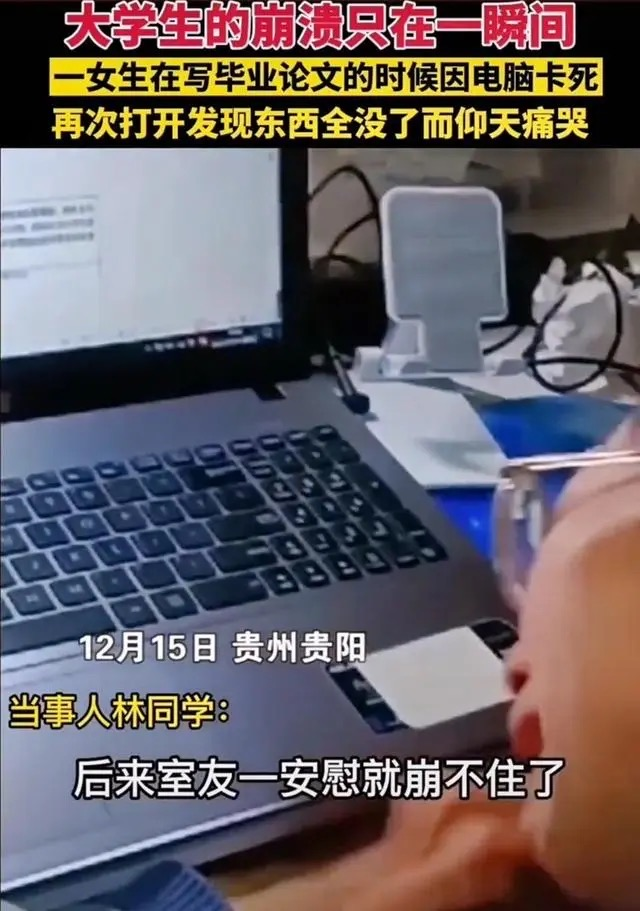
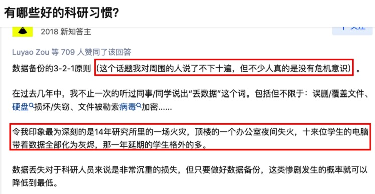
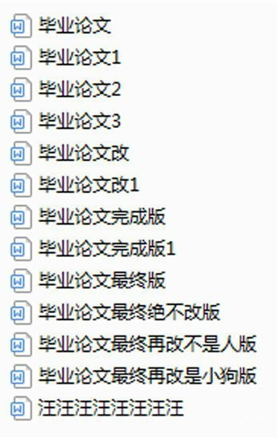

::: {#xp-guide-backup}
:::

::: {.contribution authors="unknown" status="unverified"}

A quick read is worth your while; a second look could save you a fortune.

:::

::: {.contribution authors="kai-wu"}

*[Link: a female university student in Guiyang breaks down in tears after failing to save her 8,000-character graduation thesis](https://baijiahao.baidu.com/s?id=1719578217211021768)*

Most students bought their own computers as undergraduates. Although everything from coursework to their current PhD research data and papers is stored on that one computer, many do not sufficiently appreciate either its importance or the fragility of the information it holds. Every year something like the incident above happens, dealing the person involved the added blow of making the news and being laughed at by people across the country.

Losing a paper you are writing is actually a relatively small matter, provided all your research materials are still there. The person in that news story rewrote her thesis in just a few days. But are those extremely important files that you never normally touch absolutely safe either?

Imagine that:

- One day your hand slips and your computer falls to the floor. It never turns on again, and the drive cannot be recovered.

- On a groggy day, you make a coffee, spill it on your computer, and instantly short-circuit it, leaving it sizzling.

- You accidentally click a link and get ransomware; or an attack compromises XJTLU's internal network and infects every computer. All your files are encrypted and locked.

- You take your computer out to work or collect data, and the entire computer is stolen.

- While travelling home for Chinese New Year, your backpack or suitcase is stolen or taken by mistake.

- No ill wishes intended, but what if XJTLU catches fire, floods (the fifth floor of MB leaks whenever it rains heavily), or a building collapses, and you have no time to retrieve your computer while evacuating?

*<https://www.zhihu.com/question/394796969/answer/1501840215>*

Any one of these events may be rare. Add all the possibilities together over three or four years, though, and the chance of at least one happening is not small. If it does happen, how long will your PhD progress be delayed, and how much of your youth will it cost?

Data with only one copy is very fragile. Think now about the computer, data, and thesis you rely on: do you have only one copy? If so, get out of your chair immediately, wash your face in the bathroom, ask yourself how a grown adult can be so carefree about this, and then read the guide below.

:::

## Theory: the 3-2-1 rule {#理论321原则}

::: {.contribution authors="kai-wu"}

The 3-2-1 rule is a standard golden rule for corporate data backups:

- 3: keep three complete copies of your files: the original and two backups.

- 2: keep the files on at least two different types of storage media.

- 1: keep one copy off site.

"Media" means different storage types such as internal drives, external drives, USB sticks, and cloud storage. It may sound troublesome, but our simplest practical setup is to keep the original on the internal drive and the two copies on an external drive and in the cloud. That meets all three requirements at once. Look back at every disaster I listed above: you could handle all of them comfortably, even the cloud storage company suddenly going out of business, without disrupting your research!

:::

## Practice {#实践}

::: {.contribution authors="kai-wu"}

Time to get things ready. First decide the scope of your backups based on the resources you have. With plenty of money, you could back up the whole computer both locally and to the cloud. Often, however, cloud capacity is small, the external drive is not big enough, or uploading lots of data is too slow. So set your backup scope first.

- The most economical option: back up only your most important files, such as papers, research materials, CV, and desktop. Use continuous cloud backup plus periodic external-drive backup. This requires very little cloud or external-drive space.

- The most efficient option: back up the entire computer locally, including the most important data, and add a continuous cloud backup of the most important research files and papers. This needs an external drive larger than your computer's drive, which is not expensive, plus a normal amount of cloud storage, around 10 GB.

- ~~The lavish option: buy a NAS, install tens of terabytes of drives, use RAID 1, and continuously send another copy off site.~~

A normal computer's drive is usually no larger than 2 TB. I also assume that buying an external drive of at least 2 TB for under RMB 500 should not be too much pressure. If your supervisor has sufficient funding, simply ask whether they can buy an external drive for your backups; purchases under RMB 2,000 are straightforward to reimburse. So I will cover only the efficient middle option below.

:::

### Full-computer backup {#sec.pc_backup}

::: {.contribution authors="kai-wu"}

A major advantage of backing up the entire computer is that, if the computer is completely lost, you can buy a replacement and restore your previous working setup within a day, picking up seamlessly without affecting your research.

Both Windows and macOS include system-level full-computer backup tools. There are plenty of tutorials online, so I will not repeat them here.

- On Windows, search Bilibili for "windows备份". The usual tool is the system's "Backup and Restore (Windows 7)". Despite the name, it works on Windows 10 and 11 too, which is why it has never been removed. For example: <https://www.bilibili.com/video/BV1Dy4y1x7RP>.

- On macOS, search Bilibili for "mac time machine". The usual tool is Time Machine in System Settings. For example: <https://www.bilibili.com/video/BV1oy4y177qS>.

If one video does not make sense, watch a few more, and make good use of Google, Zhihu, and other resources. Beginners may find the learning curve a little steep, but do not wait until your computer breaks before preparing.

:::

### Cloud backup {#sec.net_drive_backup}

::: {.contribution authors="kai-wu"}

Box (<https://box.xjtlu.edu.cn/>) is the university's self-hosted cloud drive. In 2022 it was upgraded to 100 GB of free space per person, with gigabit upload and download speeds on the internal network and three months of file history, outperforming many commercial services. Drag important folders into the Seafile client without moving the folders themselves, and it will automatically back them up to the university cloud in real time. Instructions: <https://guide.xjtlu.edu.cn/box/student/drive_client/drive_clent_for_windows.html>. The only problem with Box is that we cannot share files via links; staff have sharing permission, but we do not. As a backup drive, though, it is very suitable.

If you do not entirely trust university IT, you can also install a commercial cloud drive as a second cloud backup. Personally, I strongly advise against Baidu Cloud because it sometimes randomly loses files. For a Chinese service I recommend Nutstore, whose free tier has unlimited storage but a monthly transfer limit. For an overseas service, I recommend OneDrive: a personal account gets 5 GB free, and you can search Taobao for a OneDrive storage expansion costing a few yuan to increase it permanently to 15 GB. Everyone also has 1 TB of free OneDrive storage through their Liverpool account, so make use of it. Remember to move your data out before graduation because the account will be withdrawn. See [Benefits included with your Liverpool account](../resources/liverpool-account.qmd#sec.fuli_liverpool).

:::

## Thesis backups and file version history {#论文备份文件历史版本}

::: {.contribution authors="kai-wu"}

The disaster-prevention methods above address most data-loss scenarios. But your papers, including your thesis and journal articles, are among your most important and vulnerable files. Besides losing them, two more catastrophes are especially worrying:

1. Version confusion. It is normal to go through dozens of revisions between starting and finishing a paper. Near submission, in particular, comments from your supervisor, second supervisor, and collaborators will surely lead to another dozen rounds. Differences between versions may be tiny and difficult to distinguish by eye. One day you will no longer know which version is which or remember what you changed in each, repeatedly wasting time sorting them out and eventually causing the problem below.

2. Overwriting files. For example, (1) a new version overwrites an old one, but later you need the old one for some reason; or (2) an old version overwrites the new one, wiping out months of revisions.

If you are interested, try an experiment now: create a file and write something in it. Create a second file with the same name in another folder and write something else. Drag it over to replace the first file. Now see whether you have any way to retrieve the first file's content.

You may ask: have we not just discussed all those backup methods? Yes, but they mainly prevent loss, such as a stolen computer or a failed drive. Few prevent overwriting. With continuous cloud backup, accidentally overwriting the local file immediately overwrites the cloud copy too. An external backup drive may offer a chance if backups are infrequent, but after some time the old version may be gone there too.

For the safety of your thesis, your lifeline, an extra layer of protection is therefore well worth it:

1. On Windows, enable system-level File History: <https://www.asus.com.cn/support/FAQ/1013067/>. Remember to add your thesis folder, or it will not be protected.

2. Mac Time Machine backups include file history. Configure it as described under [Full-computer backup](#sec.pc_backup), and the history of the entire computer is included.

3. Linux users: I am sure you have plenty of options. The simplest is to write a shell script that copies the thesis folder to another directory named with the date, then schedule it in crontab.

4. Those methods enable local file history. Some cloud drives also provide version history, though they usually limit the number or age of versions, or require a paid subscription to enable it. Once enabled, you also have history in the cloud, which could save you after an accidental overwrite if your local setup was incorrect or unavailable for another reason. The university's Seadrive includes roughly two months of file versions for free, which is very generous. Again, I recommend using it. Simply drag the folder in for backup and versions are generated automatically. See [Cloud backup](#sec.net_drive_backup).

5. If you know some Git and GitHub, turn the whole thesis folder into a Git repository and upload it to a private GitHub repository. At the end of each working day, commit a backup version and record what you changed. For papers, Git is the ideal backup solution: you can easily return to old versions without worrying about overwriting them, and even identify when a particular change was introduced. It is more reliable than all the methods above. Overleaf also has GitHub integration for convenient collaboration with your supervisor. Git does have a somewhat steeper learning curve, but there are countless detailed tutorials online for interested students with time to learn.

(Information dated: 2 December 2022)

(Major update: 30 December 2022)

:::
