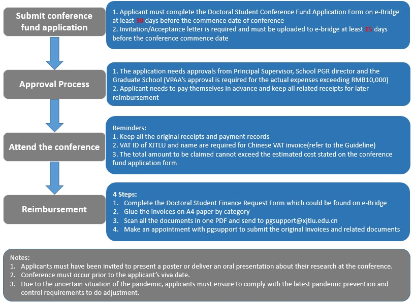

::: {#xp-guide-conference-funding}
:::

::: {#sec.fund}
:::

::: {.contribution authors="kai-wu"}

Every student, whether self-funded or on a scholarship, has RMB 16,500 in conference funding. It can reimburse registration, accommodation, travel, and other costs of attending conferences. It would be a shame not to use it before graduating to ~~eat, drink, and have fun around the conference~~ broaden your academic experience. Although the allowance is generous, applying and claiming reimbursement is rather complicated. The main information is available here:

- ebridge: <https://ebridge.xjtlu.edu.cn/>. After logging in, select "PGR Policies, Procedures and Forms" and find *Postgraduate Research Students' Conference Fund Policy* and *Guideline and Procedures on Doctoral Student Travel Arrangement and Reimbursement*.

- The official flowchart:

  

Please note:

1.  You must apply at least 30 days in advance. This means it cannot cover a conference you suddenly hear about that starts in fewer than 30 days.

2.  You must present at the conference, either a poster or an oral presentation. Otherwise you cannot use this funding.

3.  If University conference funding cannot be used, your supervisor may have other funds available. For these reasons, I have claimed expenses for several conferences from my supervisor's funding. Ask your own supervisor whether they have suitable funds and how to use them.

(Information dated: 12 October 2022)

:::
