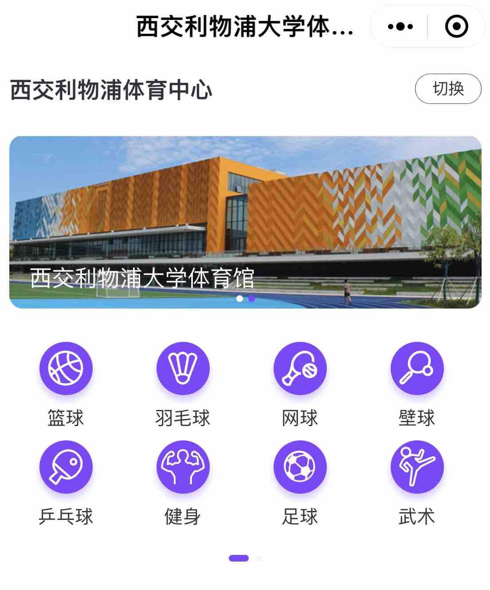

::: {#xp-guide-sports-vouchers}
:::

::: {.contribution authors="kai-wu"}

The University's sports centre operates commercially, so it charges for use. However, the WeChat mini program "西浦体育中心" issues RMB 100 in vouchers each month. They can be used to book basketball courts, table tennis tables, gym time, and more; explore the mini program for details. The University gym is very well equipped, and its equipment is new. If you have never visited, go and explore it soon. A voucher is essentially \[a balance with an expiry date\]: unused value is retained. For example, if you use a RMB 100 voucher for a RMB 25 gym booking, you receive a RMB 75 voucher, but vouchers do expire.

After booking, use your XJTLU campus card to enter the sports centre, then scan the QR code for your booked facility at its entrance.

(12 October 2022, by [Kai Wu](mailto:kaiwu.astro@gmail.com))

:::
