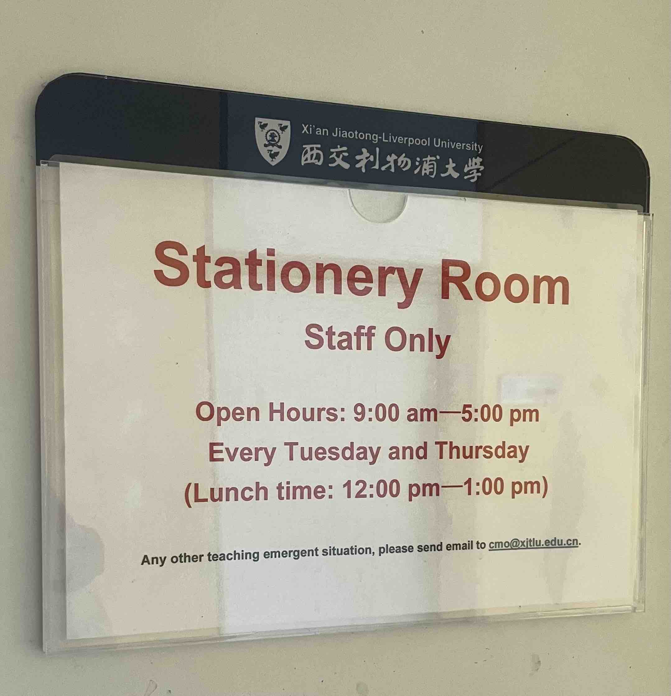
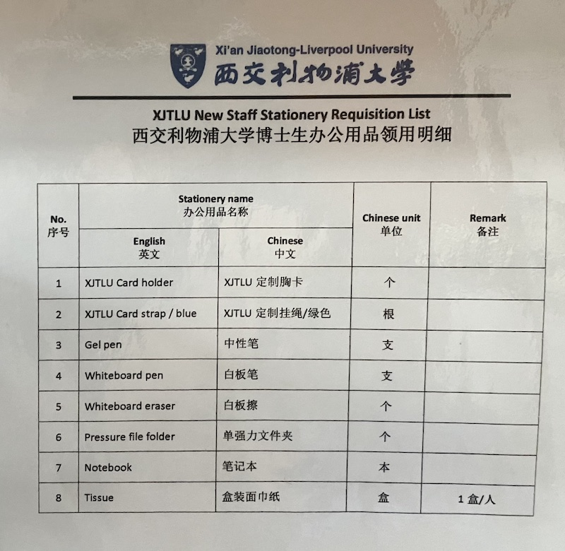

::: {#xp-guide-stationery}
:::

::: {.contribution authors="kai-wu"}

After the generous conference allowance, free office supplies may save you the most money. Many University buildings have stationery rooms where you can collect supplies: tissues, pens, markers, highlighters, organisers, tape, glue, staplers, and almost anything else you can think of.

Where are the stationery rooms?

- MB128: Tuesdays and Thursdays, 9-11 am and 1-5 pm.

- BSG35: Tuesdays and Thursdays, 9-11 am and 1-5 pm. Thanks to an anonymous student for this addition.

- HS building property management office: Tuesdays and Thursdays, 9-11 am and 1-5 pm; Fridays, 9-11 am. Thanks to an anonymous student for this addition.

- Other buildings? Readers, please add them.

\
How to collect supplies:

1.  Before your first collection, go to a stationery room and ask the staff what you can take. They will give you a booklet. Photograph everything in it so you know what is available next time. Alternatively, a historical version kindly uploaded by a student can be found here: [\[GitHub link\]](https://github.com/kaiwu-astro/xp_pgrs_unofficial_guide/tree/main/fileshare) [\[Alternative if GitHub is inaccessible\]](https://gitee.com/kaiwu-astro/xp_pgrs_unofficial_guide/tree/main/fileshare). The current contents may differ slightly.

2.  Download the latest *(CMO) Office Supplies Application Form*. The latest version is currently V3. Older versions generally cannot be used after a new one is released. Where can we get an update if this becomes outdated? Unfortunately, we cannot download it directly ~~another complaint about the University~~. Usually, ask your supervisor: supervisors can generally find it in the University's Box storage. Here is the [copy I use](https://github.com/kaiwu-astro/xp_pgrs_unofficial_guide/tree/main/fileshare), with a [backup link](https://gitee.com/kaiwu-astro/xp_pgrs_unofficial_guide/tree/main/fileshare).

3.  Complete the form accurately. The first column, \[office supply name\], must match the booklet exactly. You cannot take too much at once; the staff will check. Tissues are limited to one box per collection. Pens are generally issued individually, rather than by the box, although requesting 12 pens is effectively one box. Give a simple, truthful reason on the right: tissues for everyday use, pens for calculations, a stapler for organising papers, or glue for reimbursement documents, for example. Finally, obtain your supervisor's signature. Electronic signatures apparently are not accepted, nor can you photocopy a form once it has been signed, although these were common workarounds with earlier versions. Take your completed form to the stationery room during its opening hours and enjoy your free shopping.

4.  June 2023 update: the items below can be collected without completing the form. Other items still require the normal form.

(Information dated: 12 October 2022)

:::
