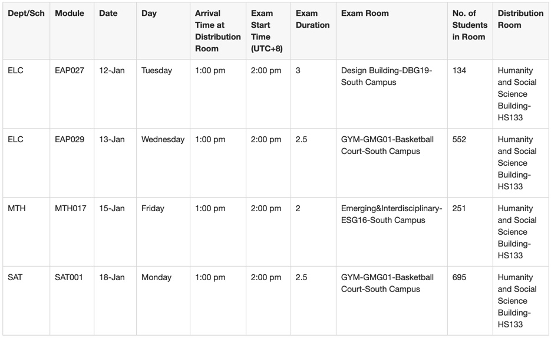
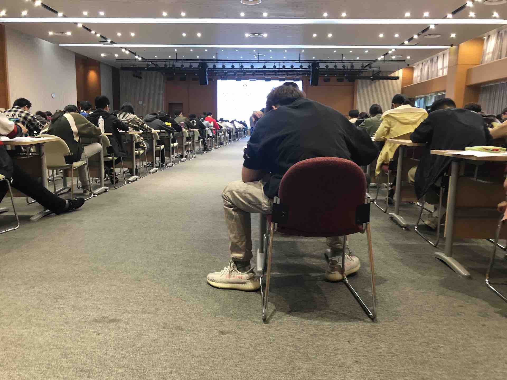

::: {#xp-guide-invigilation}
:::

## How to take part {#如何参加}

::: {.contribution authors="kai-wu,yue-zhou" status="unverified"}

If fully funded PhD students have not completed their required TA hours, their school will assign them invigilation work. There are only two exam periods per semester: midterms and finals. Because of the pandemic over the past two years, it has been a long time since we had in-person exams.

When there are too many exams for staff and fully funded PhD students to cover, PhD students without full funding can also sign up as invigilators. Wait for the university's invitation email. It will contain a link where you can choose suitable times. A few days after making your selection, you can check your specific assignments on e-Bridge.

In 2022, the invigilation pay rate was RMB 60 per hour. There is little preparation, and during the exam you mostly walk around. It is comparatively easy work and a good way for students without full funding to earn some money.

:::

## What to do {#具体怎么做}

::: {.contribution authors="kai-wu,yue-zhou" status="unverified"}

First, the university provides invigilation training. Look for the Assessment and invigilation session in the email titled *Teaching Assistant (TA) Training Programme*, or find it on LMO. If you have never attended, consider going once to learn the overall process.

An exam room has a senior invigilator (a member of staff) and invigilation assistants (PhD students).

Here is my summary of the process:

1. Although you do not have to attend the training every time, invigilator badges are usually distributed at the semester's training session. You must wear your badge while invigilating and return it to the university afterwards. Even if you do not want to attend, you therefore need to make a trip to collect it. If you are lazier, like me, ask an office mate who is also invigilating to collect it for you. Usually one person picks up the whole office's badges.

2. Check your invigilation schedule on e-Bridge, as shown below.

   

3. Part one is preparation. Before the exam, check the columns "Arrive Time at Distribution Room" and "Distribution Room" in the schedule above. Arrive at the designated room at the specified time to sign in and collect the exam papers. You will also receive MCQ cards, answer booklets, candidate lists, small white cards, adhesive putty, and other materials to take to the exam room.

4. On reaching the exam room, first put up the materials. Among the candidate lists, one is sorted by student ID and should be displayed on the door so students can find their seats. The other copies, sorted by seat, are for invigilators. Separate the pages of the student-ID list and use the putty to attach them to the door or wall.

5. Start distributing answer booklets and answer sheets according to the seating plan.

6. There are usually several invigilators in one room. When the others arrive, share out the distribution of booklets and sheets. Agree which area each person will cover. Each invigilator is responsible for patrolling their area and collecting materials from it.

7. The senior invigilator will bring the exam papers. Help distribute them. If the senior invigilator has not arrived 20 minutes before the exam starts, contact a teacher in the invigilators' WeChat group to follow up.

8. All materials, including question papers, answer sheets, and MCQ cards, must be distributed 15 minutes before the exam. Admit students 15 minutes before the start.

9. When several invigilators are present, usually at least one stays at each entrance to check student cards. Students without a student card or ID card are not allowed in. The others can patrol the room. Watch particularly for students opening their question booklets before the exam starts, and stop them immediately if they do. If many are doing it, ask the senior invigilator to issue a warning. To prevent belongings going missing, do not leave students' bags outside the room. They should put them only at the very front or back of the room.

10. After the senior invigilator announces the start, record late arrivals in your area. You can note them on your candidate list.

11. Once the exam has started, walk around and enjoy your authority as an invigilator. Pay particular attention to students' belongings and look for notes written on hands or slips of paper. Do not look at your phone or chat during the exam: watch for cheating. If you encounter cheating, point it out immediately, stop the student from continuing the exam, and mark the paper.

12. Thirty minutes after the start, collect the small white cards used for names, student IDs, and similar information. Then record absent students in your area.

13. If a student needs to borrow a pen, pencil, or eraser, ask the senior invigilator what to do. If a student needs the toilet, an invigilator must accompany them there and back; waiting outside the toilet is enough, though that probably goes without saying. In principle, only one student may use the toilet at a time. A second student must wait until the first has returned.

14. At the end of the exam, collect all materials, including scrap paper if there is any. Students must wait until everything has been collected and the counts checked before standing up and leaving.

15. After the exam, tally attendance, late arrivals, absences, and so on, and have the senior invigilator enter them on the record sheet. There are two sheets that all invigilators must sign. Those two signatures, plus the initial sign-in, are required for your work to be successfully recorded.

16. Then it is time to say goodbye. The senior invigilator takes the answer booklets and MCQ cards. Return the two signed sheets and all other materials the senior invigilator does not want, including question papers and scrap paper, to the room where you originally signed in. If this is your last assignment of the semester, return your invigilator badge as well.

Finally, here is the checklist I use after invigilating more than a dozen times:

1. When collecting materials, check the number of invigilators so you can divide the room into areas.

2. Put up the seating plan when you reach the room.

3. Confirm the following with the senior invigilator:

   1. Must answer booklets be collected in order? If so, do not let students pass papers along at the end. Leave booklets for absent students and early finishers on the desks too.

   2. Do booklets need to be sealed? If so, have students do this at the end.

   3. Do toilet visits and their start and end times need to be recorded?

   4. How should absences be handled? Fill in the information on the white card and answer booklet, and write "Absent" on the booklet.

4. Once you have the seat numbers, divide the room into areas according to the number of invigilators. Each person handles everything in their area apart from collecting papers:

   1. Before the exam: distribute papers, check that students are in the right seats, and make sure they do not open the white question booklet.

   2. Admission: check student cards at the door.

   3. Minutes 0-30: check seating and record late arrivals.

   4. At 30 minutes: record absences and collect white cards. Then complete the attendance form.

   5. Toilet visits: record the seat number and start and end times.

   6. With 15 minutes remaining: record the seat numbers and number of early finishers.

5. Before the end: remind the senior invigilator to ask students to seal their answer booklets.

6. After the exam: collect answers in order, count the portion you collected, and then recount a random portion after the papers have been brought together.

7. Make a table for each area: total students, absent, handed in early, remaining, and special cases.

*Invigilating an exam on the ground floor of CB, 15 November 2020.*

(Information dated: 22 October 2022)

(Major update: 30 December 2022)

:::
