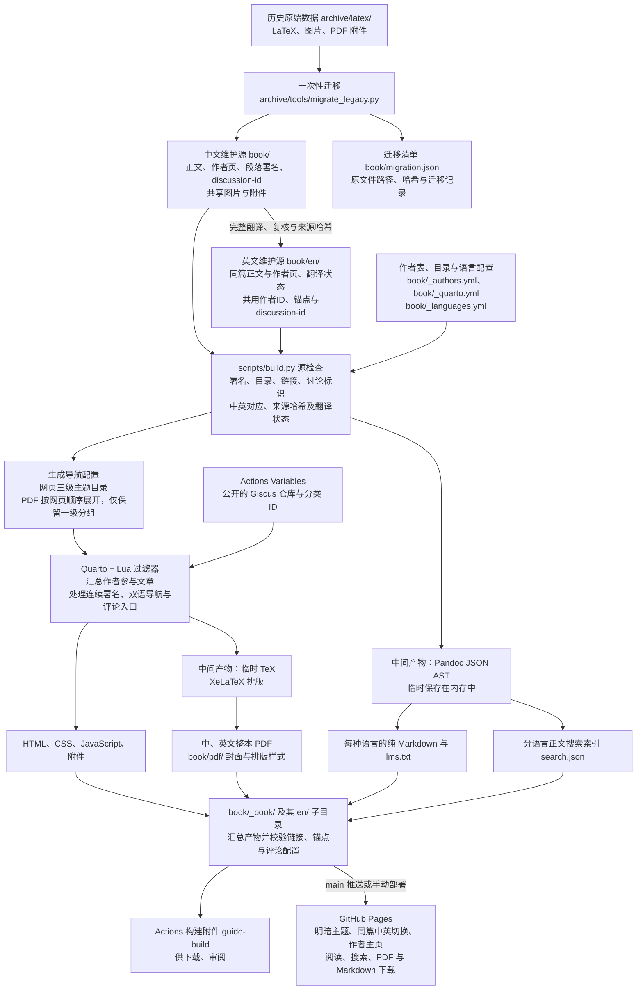
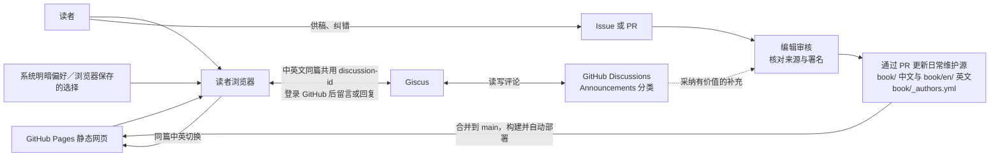

# 项目数据流

项目以 Quarto Markdown（`.qmd`）维护中文正文和逐篇对应的英文译文，每种语言生成网页、整本 PDF 和供读者、LLM agent 阅读的纯 Markdown。历史 LaTeX 只参与一次性迁移；日常发布从当前 `.qmd` 源文件开始。评论在读者访问网页时单独加载。

日常改稿、审核和发布的人工／自动步骤，以及维护者需要关注的入口，见[更新与维护流程](maintenance-workflow.md)。

## 从原始材料到发布产物

各类数据的维护位置如下：

| 数据 | 位置与用途 |
| --- | --- |
| 历史原稿 | `archive/latex/` 保留旧 LaTeX 入口、章节、作者资料、图片及附件的原有相对目录，用于核对原文与迁移来源；旧工作流和导入工具同在 `archive/`，见[归档说明](../archive/README.md)。 |
| 当前正文 | 首页与新手导航为 `book/index.qmd`；其余文章在 `book/content/` 下的 `academic/`、`resources/`、`research/`、`work/`、`life/`、`social/` 六个主题目录，以及 `about/` 辅助目录中，供稿说明为 `book/content/about/contributing.qmd`。frontmatter 保存标题和稳定的 `discussion-id`，正文块保存原作者与补充者 ID。 |
| 英文译文 | `book/en/` 镜像中文正文和作者页。frontmatter 的 `translation-source` 和 `translation-source-sha256` 记录中文来源；`draft` 初稿在网页和导出中提示待人工复核。 |
| 作者、目录与样式 | `book/_authors.yml` 提供同一作者 ID 的中英文显示名；`book/authors/` 与 `book/en/authors/` 保存作者页，参与文章由署名块自动汇总。`book/_quarto.yml` 和 `book/_languages.yml` 维护共享目录和语言译名，构建生成英文项目配置及两种语言的 PDF 专用扁平章节配置；`book/filters/`、`book/assets/` 和 `book/pdf/` 提供处理、资源与 PDF 样式。 |
| 迁移记录 | `book/migration.json` 记录原始材料及迁移情况，用于追溯；迁移脚本不在日常构建中执行。 |
| 旧地址别名 | `book/redirects.yml` 记录旧 `.qmd` 路径到当前文件的映射，用于生成兼容旧链接的 HTML 跳转页和 Markdown 迁移提示。 |
| 暂态中间数据 | Pandoc JSON AST 由程序读取到内存，供校验、Markdown 导出和搜索索引使用；英文项目配置和 PDF 专用章节配置由共享目录生成，Quarto 为 PDF 排版生成临时 TeX。它们不是持续维护的正文副本。 |
| 生成结果 | `book/_book/` 包含中文网页、网站资源、`xp-pgrs-unofficial-guide.pdf`、`markdown/`、`llms.txt` 和 `search.json`；其 `en/` 子目录包含英文对应产物，由同一构建命令生成。 |

图中的 AST 节点概括了解析后的文档结构；源检查、导出和 Quarto 渲染会按各自需要解析正文，程序不维护一份长期保存的 AST 文件。搜索索引按语言取自正文，避免把重复署名提示、供稿按钮等界面文本混入检索结果。英文项目的 `_quarto.yml` 和 PDF 专用扁平章节配置是从共享配置生成的中间配置，维护时不编辑或提交。

构建核对中英文页面、标题锚点及署名块的对应关系，并拒绝缺失或来源哈希过期的译文。网页将连续相同原作者、补充者与确认状态的内容合并显示一次署名；PDF 在每章内也按这三项合并连续署名，跨小节适用，任一项变化、切回先前署名或进入新章时重新显示。源块和 Markdown 仍逐块保留作者归属。作者主页从这些署名字段汇总，不依据 Git 提交者或未确认的个人信息推断。

迁移清单的 `legacy_root` 指向仓库内的 `archive/latex`；清单中的原稿路径、来源哈希键，以及文章 frontmatter 的 `legacy-source` 均相对这个目录，保留归档前的相对路径和来源哈希。当前正文与资源的 `path`、`replacement` 相对 `book/`，`import_path` 和 `import_replacement` 保留最初导入时的位置。一次性迁移脚本已归档，它用于还原最初导入过程，会拒绝覆盖已有 `.qmd`，不负责重新生成当前维护中的文章布局。

文件夹按主题组织维护源，阅读顺序由 `book/_quarto.yml` 的显式章节目录决定。网站使用 `part/contents` 与 `section/contents` 组织“一级主题 → 二级专题 → 具体文章”；PDF 从同一目录树按顺序展开文章，只保留一级主题及辅助分组。构建递归发现各层 `.qmd`，并校验每种语言的章节目录是否完整覆盖全部正文与作者页，以及是否重复。每篇文章有一个主要归属，其它栏目用链接关联；待补导览明确区分已有攻略和规划选题。旧 HTML 地址通过生成的跳转页保留查询参数和锚点，旧 Markdown 地址提供迁移提示；这些兼容文件由当前正文和别名表生成，旧位置不保存重复正文源。新增和移动文章的步骤见[文章目录与文件移动](../CONTRIBUTING.md#文章目录与文件移动)。

`scripts/build.py` 先检查源文件，再渲染、导出并校验生成结果。修改应写回 `.qmd`、作者表或配置；`book/_book/` 是生成目录。Actions 为分支构建保留附件；只有 `main` 的推送或手动运行会发布 Pages。其他分支用于修改与审核，PR 合并到 `main` 后自动更新网站。具体操作见[维护者设置与发布](maintainer-setup.md)。

## 读者评论、供稿与编辑采纳

构建时只把公开的 Giscus 仓库 ID、分类 ID 和文章 `discussion-id` 写入 HTML。读者打开网页后，浏览器通过 Giscus 从 GitHub Discussions 加载评论；留言与回应写入 Discussions，首次留言或回应时由 Giscus 自动建立对应讨论。

评论和 Issue 是待整理的输入，PR 是待审核的正文变更。编辑核对来源、署名和适用时间后，将采用的内容写入 `.qmd`，必要时登记作者，再通过构建发布。经采纳的内容才进入后续网页、PDF 和 Markdown；评论本身独立保存在 Discussions。

网页的系统默认主题与手动选择由浏览器处理，手动偏好在中英切换后保留，Giscus 跟随当前主题。语言切换指向本站对应文章；独立的历史英文仓库不是切换目标。

`discussion-id` 是文章与讨论之间的稳定关联，应在改标题、移动文件或切换语言时保留。拆分时原流程或入门页保留原讨论与旧小节入口，新文章分配新讨论标识和标题锚点；实质正文及署名随内容移动。合并时保留主讨论标识和各旧页首锚点；旧讨论不会自动迁移或合并，已有独立讨论通过链接保留入口。同篇中英文共享讨论，构建按语言生成评论界面。段落署名中的作者 ID 则通过 `book/_authors.yml` 解析，记录实际内容提供者。具体供稿方式和署名格式见[贡献说明](../CONTRIBUTING.md)。
