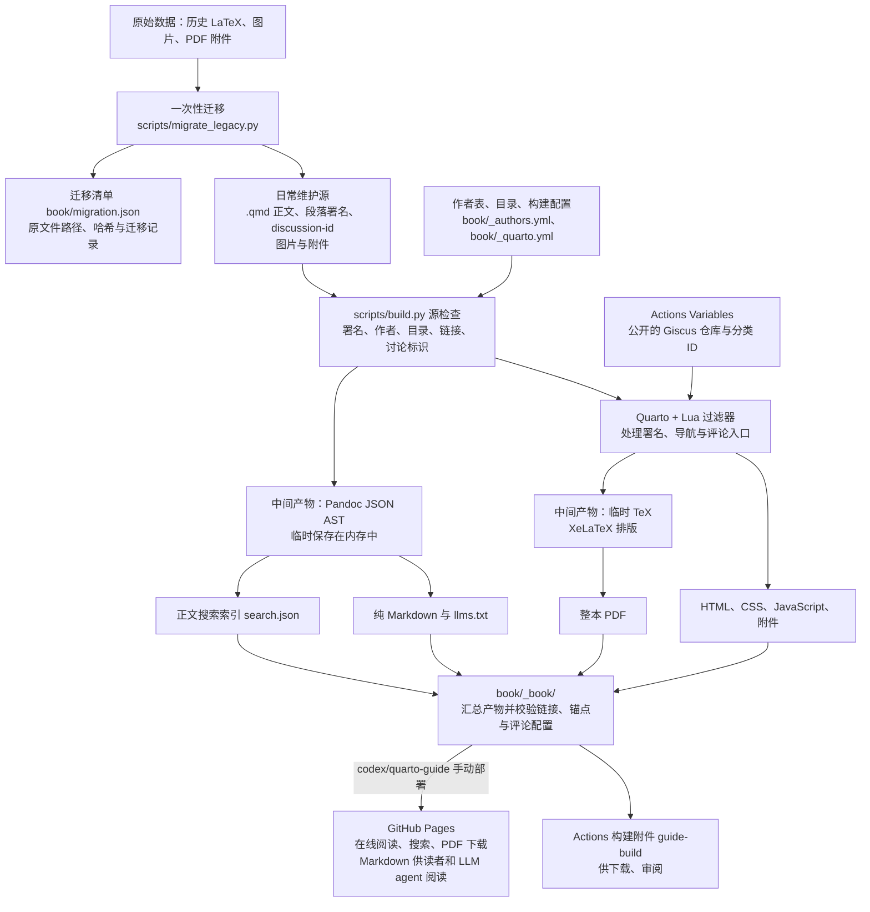
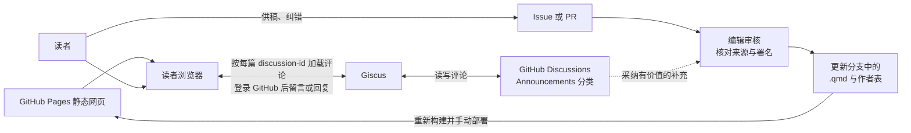

# 项目数据流

项目以 Quarto Markdown（`.qmd`）作为统一正文来源，生成网页、整本 PDF 和供读者、LLM agent 阅读的纯 Markdown。历史 LaTeX 只参与一次性迁移；日常发布从当前 `.qmd` 源文件开始。评论在读者访问网页时单独加载。

## 从原始材料到发布产物

各类数据的维护位置如下：

| 数据 | 位置与用途 |
| --- | --- |
| 历史原稿 | 根目录 LaTeX 入口、`chapters/`、`author-folder/`，用于核对原文与迁移来源。 |
| 当前正文 | 首页为 `book/index.qmd`；其余文章在 `book/content/` 下的 `getting-started/`、`milestones/`、`resources/`、`research-work/`、`life-tools/`、`appendix/` 六个主题目录中，供稿说明为 `book/content/appendix/contributing.qmd`。frontmatter 保存标题和稳定的 `discussion-id`，正文块保存原作者与补充者 ID。 |
| 作者、目录与样式 | `book/_authors.yml` 将作者 ID 对应到显示名；`book/_quarto.yml` 配置目录与输出；`book/filters/` 和 `book/assets/` 提供格式处理、样式、脚本及附件。 |
| 迁移记录 | `book/migration.json` 记录原始材料及迁移情况，用于追溯；迁移脚本不在日常构建中执行。 |
| 旧地址别名 | `book/redirects.yml` 记录旧 `.qmd` 路径到当前文件的映射，用于生成兼容旧链接的 HTML 跳转页和 Markdown 迁移提示。 |
| 暂态中间数据 | Pandoc JSON AST 由程序读取到内存，供校验、Markdown 导出和搜索索引使用；Quarto 为 PDF 排版生成临时 TeX。它们不是持续维护的正文副本。 |
| 生成结果 | `book/_book/` 包含网页、网站资源、`xp-pgrs-unofficial-guide.pdf`、`markdown/`、`llms.txt` 和 `search.json`，由构建重新生成。 |

图中的 AST 节点概括了解析后的文档结构；源检查、导出和 Quarto 渲染会按各自需要解析正文，程序不维护一份长期保存的 AST 文件。搜索索引取自正文，避免把重复署名提示、供稿按钮等界面文本混入检索结果。

迁移清单中的 `path` 和 `replacement` 跟随当前目录位置，`import_path` 和 `import_replacement` 保留最初导入时的位置；原稿路径与来源哈希保持不变。一次性迁移脚本会拒绝覆盖已有 `.qmd` 正文。

文件夹按主题组织维护源，阅读顺序由 `book/_quarto.yml` 的显式章节目录决定。构建递归发现各层 `.qmd`，并校验章节目录是否完整覆盖全部正文。旧 HTML 地址通过生成的跳转页保留查询参数和锚点，旧 Markdown 地址提供迁移提示；这些兼容文件由当前正文和别名表生成，旧位置不保存重复正文源。新增和移动文章的步骤见[文章目录与文件移动](../CONTRIBUTING.md#文章目录与文件移动)。

`scripts/build.py` 先检查源文件，再渲染、导出并校验生成结果。修改应写回 `.qmd`、作者表或配置；`book/_book/` 是生成目录。Actions 为普通分支推送保留构建附件；当前 `codex/quarto-guide` 分支需要手动触发才发布 Pages。发布此分支不会修改或合并 `main`。具体操作见[维护者设置与发布](maintainer-setup.md)。

## 读者评论、供稿与编辑采纳

构建时只把公开的 Giscus 仓库 ID、分类 ID 和文章 `discussion-id` 写入 HTML。读者打开网页后，浏览器通过 Giscus 从 GitHub Discussions 加载评论；留言与回应写入 Discussions，首次留言或回应时由 Giscus 自动建立对应讨论。

评论和 Issue 是待整理的输入，PR 是待审核的正文变更。编辑核对来源、署名和适用时间后，将采用的内容写入 `.qmd`，必要时登记作者，再通过构建发布。经采纳的内容才进入后续网页、PDF 和 Markdown；评论本身独立保存在 Discussions。

`discussion-id` 是文章与讨论之间的稳定关联，应在改标题、移动文件时保留。段落署名中的作者 ID 则通过 `book/_authors.yml` 解析，记录实际内容提供者。具体供稿方式和署名格式见[贡献说明](../CONTRIBUTING.md)。
