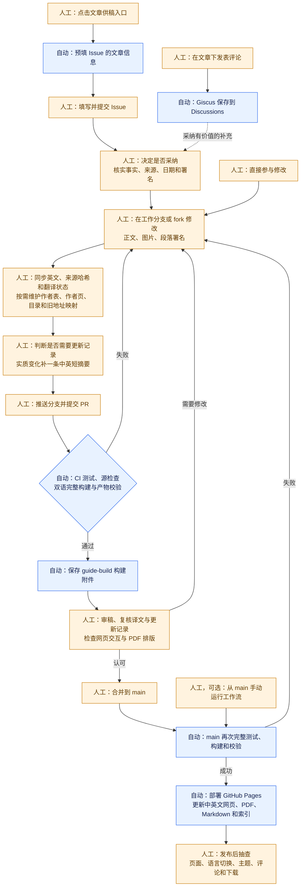
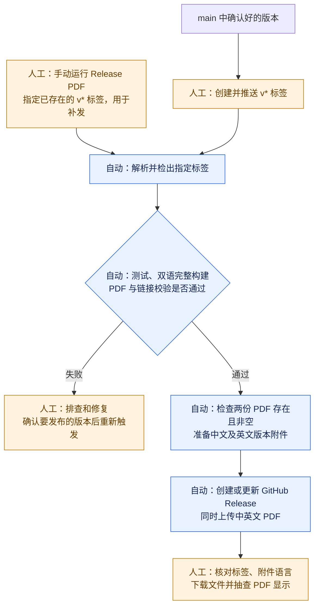

# 更新与维护流程

正式内容以 `main` 为准。贡献者或编辑在工作分支或 fork 中整理修改，经审核合并后，由工作流构建并更新网站。日常正文和文档更新无需打版本标签；需要保存一个正式版本快照时，再走 PDF Release 流程。

图中蓝色表示自动执行，橙色表示人工操作。人工步骤可由贡献者、编辑或维护者承担；CI 检查结果供审核使用，不能代替事实、署名和译文质量的判断。

## 日常更新：从建议到网站

分支推送和目标为 `main` 的 PR 自动触发 CI，成功后保存构建附件供审核。普通分支只构建；只有 `main` 的推送或从 `main` 手动运行工作流才会部署 Pages。本地检查和预览由人运行命令，检查过程由程序执行。

正文按学业、资源、研究、工作、生活、社交六个主题及“关于本指南”辅助目录维护，每篇文章只设置一个主要归属。网站的三级目录和 PDF 章节来自同一共享目录树；构建为 PDF 生成仅保留一级分组的展开配置。审核目录调整时，需同时检查中英文三级导航、PDF 阅读顺序、作者参与文章汇总和旧地址定位。待补导览只表示规划和征稿，不能作为已完成攻略发布。

Issue 和评论不会自动变成正文，也不会自动生成 PR。维护者采纳后，需要将内容整理进 `.qmd`，或协助贡献者补全已有 PR，再审核合并。直接提交的 PR 不一定有对应 Issue，审核时也要核对来源、署名和对应译文。

## 日常更新记录

编辑在 `book/updates/` 为每次逻辑上独立的实质变化新增一个 YAML 文件，填写变化日期、中英文一句话摘要、类型和相关文章稳定标识。新文章、重要补充、实质纠错与读者可感知的网站改进需要记录；错字、排版、常规翻译同步和内部构建调整通常省略。一条记录可关联多篇文章，中英文同步共用一条，不按提交数量计数。字段和可复制示例见[贡献说明](../CONTRIBUTING.md#更新记录)。

审稿时检查“是否需要更新记录”，并核对摘要是否准确、关联文章是否合适；CI 只校验已有记录，不要求每次提交都新增一条。记录随正常 PR 合并到 `main` 后发布，不需要日常版本号。日期由编辑填写，只表示这次变化的日期，不能替代正文事实的核验日期；早期网站节点依据仓库提交补录，后续记录不自动从提交历史提取。

构建从共享记录生成集中更新页的中英文近期列表，按月分组、日期倒序排列，并纳入 PDF 和 Markdown；原有六条手工记录完整保留在历史里程碑中。首页和文章页不添加更新组件。审核构建附件时同时检查两种语言的摘要、当前文章链接、手机换行和明暗主题；生成列表及暂态文件 `book/_updates.generated.yml` 不手改、不提交。

## 可选：发布版本快照

Release 同时上传 `xp_pgrs_unofficial_guide_<版本>.pdf`（中文）和 `xp_pgrs_unofficial_guide_<版本>_en.pdf`（英文）。Pages 上也提供两种语言的 PDF：Pages 跟随 `main`，Release 保留所选标签的版本快照，两者不一定是同一时间的内容。已有标签补发仍会检出该标签，不会自动包含之后对 `main` 的修改。

## 维护者需要关注哪些入口

日常内容维护需要关注 **Issues、Discussions 和 Pull requests 三个入口**。

| 入口 | 主要内容 | 维护者的处理方式 |
| --- | --- | --- |
| [Issues](https://github.com/xp-pgrs-unofficial-guide/xp_pgrs_unofficial_guide/issues) | 文字投稿、明确的纠错或更新请求、新文章建议 | 核实、澄清、安排处理；采纳后关联实现该建议的 PR，合并后关闭或说明处理结果。 |
| [Discussions](https://github.com/xp-pgrs-unofficial-guide/xp_pgrs_unofficial_guide/discussions) | 文章下的 Giscus 评论、问答和开放讨论 | 回复问题；需要持续跟进的更新可整理为 Issue，需要修改正文的内容进入 PR。 |
| [Pull requests](https://github.com/xp-pgrs-unofficial-guide/xp_pgrs_unofficial_guide/pulls) | 贡献者直接提出的正文、翻译、署名或其他文件修改 | 查看差异和 CI 结果，核对内容与署名，要求修改或合并。 |

网页评论会集中保存在本仓库的 Discussions，同篇中英文共用讨论，因此可从 Discussions 统一查看文章留言。Issue、Discussion 和 PR 可以相互链接，方便追踪从建议到采纳发布的过程；这些关联和处理决定需要人工完成。

站点与发布维护还需关注 [Actions](https://github.com/xp-pgrs-unofficial-guide/xp_pgrs_unofficial_guide/actions) 的构建、部署和 Release 结果；它是技术运行状态入口。发布后仍需人工抽查实际页面和下载文件。

## 自动化与人工工作的边界

| 环节 | 已自动化 | 仍需人工 |
| --- | --- | --- |
| 双语维护 | 检查页面对应、来源哈希、锚点与署名一致性。 | 翻译和核对语义；同步内容后更新来源哈希与 `draft`／`reviewed` 状态，不能只改哈希来掩盖未翻译的修改。 |
| 作者维护 | 按署名汇总参与文章，在网页合并显示连续相同署名。 | 确认实际归属，登记中英文作者名，创建对应作者页和目录项。 |
| 文件移动与拆分合并 | 根据别名表生成旧 HTML 跳转和 Markdown 迁移提示，并检查双语目录覆盖、锚点与署名。 | 同步改动中英文，更新目录、引用和别名；移动保留稳定 ID，拆分保留原页讨论与旧小节入口，新页分配新 ID；合并保留旧页首锚点和既有独立讨论入口。 |
| 更新记录 | 校验日期、类型、双语摘要和文章稳定标识，按当前标题与链接生成中英文更新页及 PDF、Markdown 内容。 | 判断变化是否值得记录，填写日期和摘要、关联文章，并在 PR 中审核；不要求每次提交都有记录。 |
| 投稿与评论 | 预填 Issue 的文章信息，加载并保存 Giscus 评论。 | 判断是否采纳，核实事实、来源与日期，将采用内容整理为正文和 PR。 |
| 发布检查 | 测试、完整构建、链接与锚点检查、评论配置校验、部署和附件上传。 | 内容审核、三级目录和旧小节入口检查、待补提示、网页交互与视觉检查、PDF 排版和分组抽查，以及是否发布版本的决定。 |

写作格式与本地命令见[贡献说明](../CONTRIBUTING.md)，配置和发布操作见[维护者设置](maintainer-setup.md)，原始材料与产物的关系见[项目数据流](data-flow.md)。历史 LaTeX 归档用于追溯，不参与日常构建，也无需随正文同步修改。
